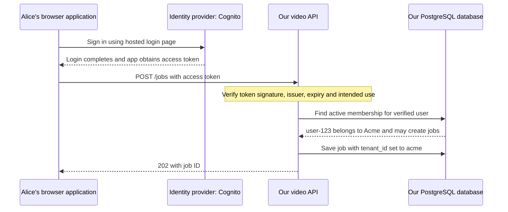
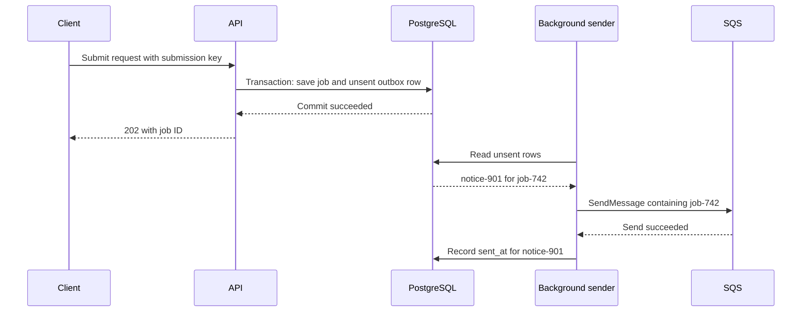
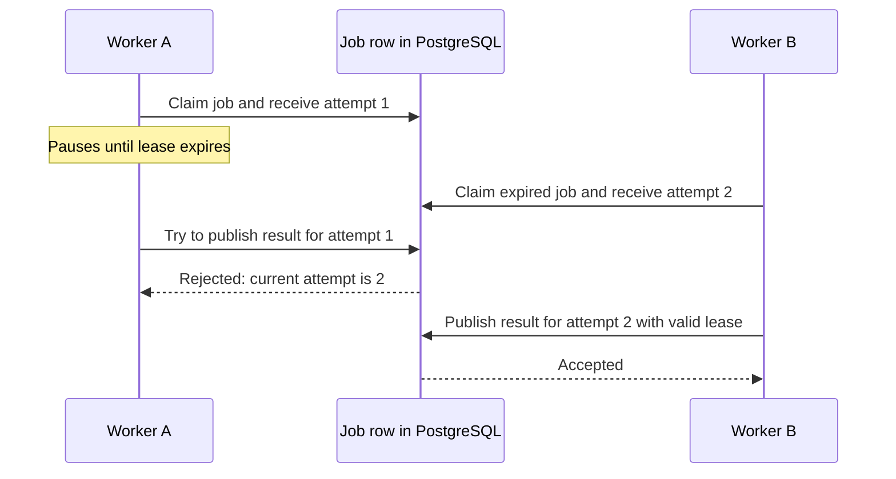
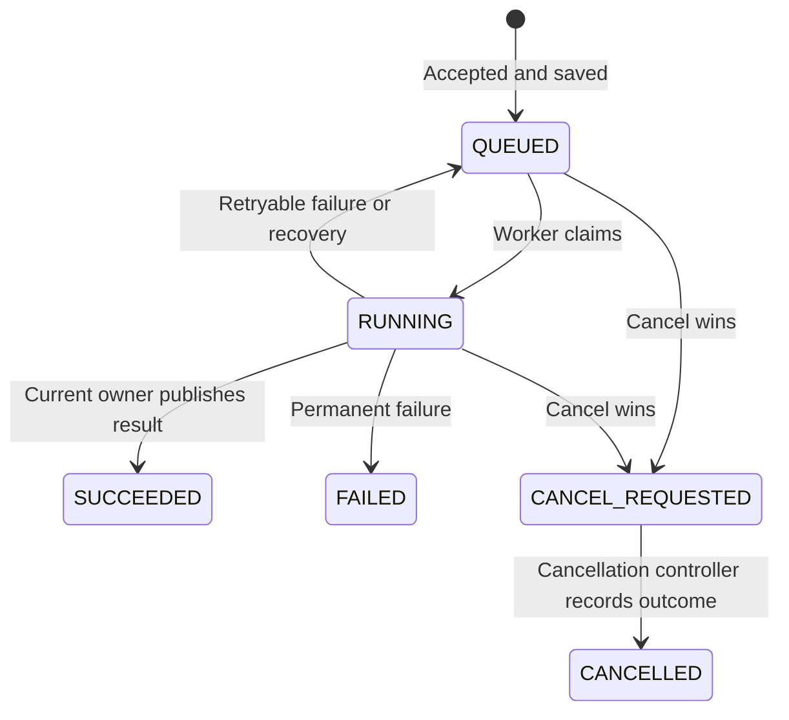

# Lesson 1 — Understanding a Reliable Video-Processing Service

Updated: **2026-11-12** (authentication explanation added; main design reviewed November 10). This is a teaching guide. Read it before attempting the exercise if these
concepts are new. Interview presentation is a separate section near the end.

We will follow one request through one concrete design, then introduce problems one at a time.
The Amazon Web Services (**AWS**) products below are practical implementation choices, not a requirement to use AWS or deploy
anything now. Examples are illustrative; no service has been built or benchmarked for this lesson.

## Contents

- [1. What are we building?](#1-what-are-we-building)
- [2. The whole design in one picture](#2-the-whole-design-in-one-picture)
- [3. Follow one video through the system](#3-follow-one-video-through-the-system)
  - [How login becomes a trusted tenant](#how-login-becomes-a-trusted-tenant)
- [4. Problem: the client does not know whether submission worked](#4-problem-the-client-does-not-know-whether-submission-worked)
- [5. Problem: the database saves the job but nobody hears about it](#5-problem-the-database-saves-the-job-but-nobody-hears-about-it)
- [6. Problem: a worker crashes or two workers receive the same job](#6-problem-a-worker-crashes-or-two-workers-receive-the-same-job)
- [7. Problem: the output is uploaded but completion is not saved](#7-problem-the-output-is-uploaded-but-completion-is-not-saved)
- [8. Problem: cancellation and completion happen together](#8-problem-cancellation-and-completion-happen-together)
- [9. Now add capacity and customer boundaries](#9-now-add-capacity-and-customer-boundaries)
- [10. Practical alternatives and what we implement](#10-practical-alternatives-and-what-we-implement)
- [11. Check your understanding](#11-check-your-understanding)
- [12. Separately: how to present this in an interview](#12-separately-how-to-present-this-in-an-interview)
- [13. Sources and limits](#13-sources-and-limits)

## 1. What are we building?

A customer has a video and asks our service to resize it. Processing may take minutes. We want to
accept the request quickly, let the customer check progress, and eventually return the output.

A **job** is the saved request to do that work: “resize this particular video using these settings.”
A **worker** is a program running on a machine that actually reads the video and performs the
transformation. These are different things: the job should still exist if its worker crashes.

For this lesson, a **durable** record is one stored so it survives ordinary application-process or
worker restarts. A Python dictionary in the API process would not meet that requirement. Durability
against an entire region being destroyed is a larger requirement we have not promised here.

Why not do everything inside one HTTP request? **HTTP** is the request/response protocol the client
uses to communicate with our service. Keeping a request open for a 60-minute job makes disconnects,
timeouts and restarts difficult to handle. Instead, we separate **submission** from **execution**:

```text
Submit video-processing request → receive job ID quickly
                                        ↓
                            processing continues separately
                                        ↓
Check that job ID later → running, failed, cancelled, or a completed result
```

That separation is called **asynchronous processing**: the initial response arrives before the
requested work finishes. It does not mean the system forgets the work or makes the customer guess.

You can read this lesson in three sittings: sections 1–3 for the basic picture, 4–8 for failures,
and 9–12 for constraints, alternatives and practice. There is no need to memorize all of it at once.

Initially remember only three responsibilities: **remember the request, arrange for work to run,
and remember the outcome**. Everything else below protects one of those responsibilities.

## 2. The whole design in one picture

An **API**—application programming interface—is the set of operations our service exposes, such as
“submit a job” and “get its status.” An **endpoint** is a particular HTTP route implementing an
operation, such as `POST /jobs`.

Our API keeps job records in a database. A database **table** groups records with named fields;
a **row** is one record. The `jobs` table has one row per logical job.

The large videos live elsewhere, in **object storage**: a service that stores files as objects
addressed by a name, with accompanying metadata—small descriptive fields about the object. For
example, Amazon S3 (Simple Storage Service) stores an object inside a
**bucket**, its storage container, under a **key**, the object's name/path within that bucket.

A **queue** holds messages until programs receive them. A **message broker** is a service that
sits between senders and receivers and manages message delivery. Here, Amazon SQS (Simple Queue
Service) supplies that
queue/broker function. “Broker” is not another application we must build beside SQS.

```mermaid
flowchart LR
    C[Customer application] -->|Submit or check status| A[Our API program]
    A -->|Save job and notification note| D[(PostgreSQL on Amazon RDS)]
    D -->|Sender reads unsent notes| P[Our background sender]
    P -->|Send small message| Q[Amazon SQS queue]
    Q -->|Reply to a worker's receive request| W[Our worker programs]
    W -->|Read job and update progress| D
    W -->|Read input and upload output| S[(Amazon S3 videos)]
    D -->|Job state and selected output| A
    A -->|Job ID or status/result| C
```



Read the picture left to right for submission and execution. Then follow the database back to the
API to see how the customer learns the outcome. Workers ask SQS for messages; the arrow from SQS
shows the response, not SQS independently calling our worker.

The small **background sender** is our code, running separately from individual API requests. It
reads saved “tell a worker about this job” notes and sends their messages to SQS. Section 5 explains
why saving that note matters. It is a normal process, not a special AWS service.

### Concrete implementation choices

| Piece | A practical choice for this example | What it does; what we write |
|---|---|---|
| API | Python/FastAPI, running on EC2 or in Amazon ECS | We write request validation, customer access checks, submission, status and cancellation. FastAPI provides the HTTP framework. |
| Job database | Amazon RDS (Relational Database Service) running PostgreSQL | RDS operates the database service; we design the tables and write queries and state-change rules. **Relational** means records are organized into related tables. **SQL** (Structured Query Language) is the language we use to read and change those records. |
| Video storage | Amazon S3 | S3 stores input/output bytes; we decide names, permissions, retention and which output belongs to a completed job. |
| Work queue | Amazon SQS Standard | SQS stores/delivers messages. We write the sending, receiving and failure-handling code. A Standard queue can deliver a message more than once and does not promise strict order. |
| Sender and workers | Our Python programs on EC2, possibly managed using ECS | **EC2** provides virtual machines. **ECS** runs and manages packaged application processes in containers. Our code runs the video transformation on suitable machines; see the processor choices below. |

A **container** packages an application and its dependencies so a runtime can start it consistently.
It does not decide which business job to run or make that job reliable. A **CPU** is a general-purpose
processor; a **GPU** is a processor designed for large amounts of parallel computation, often used
for ML. **FFmpeg** is a practical command-line/library toolkit for processing video and audio. A
resize job might call FFmpeg; a model-based job might run our inference code on a GPU machine.
We can learn this design without first learning a container-management platform such as Kubernetes.

We use PostgreSQL to make the record changes easy to see. DynamoDB is a valid alternative, discussed
later; it is not something we also need alongside PostgreSQL in this example.

## 3. Follow one video through the system

### The request and the job record

Our customer is a company called Acme. A **tenant** is one customer organization whose data and
jobs must be isolated from other customers. Here, `tenant_id = "acme"` is its internal identifier.
The API verifies who is calling, then checks our trusted records to determine which tenant that
caller may act for. Merely putting `"tenant_id": "acme"` in a request does not grant Acme access.

### How login becomes a trusted tenant

There are two separate checks. **Authentication** establishes the caller's identity: “this request
carries valid credentials for user 123.” **Authorization** checks permission: “user 123 belongs to
Acme and may create video jobs.” A successful login alone does not grant access to every customer.

For this example, assume Alice works for Acme and uses our browser application. We use **Amazon
Cognito**, an AWS service for user sign-in, as our **identity provider**: the service responsible for
checking login credentials and issuing evidence of the login. Auth0 or Microsoft Entra ID are other
practical choices. This is a teaching implementation, not a claim about Adobe's sign-in system.



**1. Alice signs in; the provider issues an access token.**

The hosted login page checks her password, passkey or company login, and any required second
factor. Our video API does not need to implement password storage. After successful login, the
application obtains an **access token**: a credential intended for calling permitted APIs for a
limited time. A normal browser integration uses an existing login library and an authorization-code
flow: the app receives a short-lived code and exchanges it for tokens. **PKCE** adds a secret
verifier held by that login attempt so a stolen code alone is insufficient to finish the exchange.
These protocol details are handled by the login integration; they are not part of video processing.

With Cognito, the access token is a **JWT** (JSON Web Token), a structured token containing signed
statements called **claims**. **JSON** is a text format for named fields, values and lists. A decoded
view of a few illustrative claims could look like this; this is not a usable token:

```json
{
  "sub": "user-123",
  "client_id": "video-web-application",
  "token_use": "access",
  "scope": "video/jobs.write"
}
```

`sub` identifies the user within that issuer; `client_id` identifies the calling application, not
the customer organization. A **scope** is an allowed category of API action, such as creating jobs.
The complete token also identifies its issuer and expiration. These example values are shortened
for readability. An access token authorizes API use; an **ID token**, also returned by many login
systems, describes the sign-in to the client application and is not interchangeable with it here.

**2. The application attaches the token to each API request.**

```http
POST /jobs
Authorization: Bearer <access-token>
Content-Type: application/json
```

A **bearer token** can be used by whoever possesses it. The application sends it over HTTPS, which
encrypts traffic in transit. Do not put it in URLs, logs or saved example files. Alice does not
normally type her password for every request; the application carries this credential instead.

**3. Our API verifies the token before trusting its claims.**

For the signed-token scheme here, Cognito creates a **digital signature** using a private signing
key it protects. Our API checks that signature with the corresponding public verification key.
Knowing the public key lets us check signatures; it does not let us create valid ones. Changing a
user ID or a permission in the token invalidates its signature.

A configured token-verification library must check the signature and allowed signing algorithm,
trusted issuer, expiry, access-token type, and intended application/API and required scope. Cognito
access tokens identify the app with `client_id`; validate the API audience (`aud`) as well when
using its resource-bound tokens. The exact checks must match the configured provider/token format.
Simply decoding a JWT into a dictionary is not verification. A signature protects integrity; it
does not make the token's contents unreadable.

**What does “our configured issuer” actually mean?**

An **issuer** is the authority that creates and signs a token. “Configured” means our team has
explicitly told the API which authority to trust, using application settings controlled by us.
It does not mean the caller gets to choose a login service and have us trust it automatically.

For Cognito, we create a **user pool**: a particular directory of user accounts and login settings
inside our AWS setup. Cognito is the product; our specific user pool is the issuing authority in
this example. Its issuer identifier is a URL. A fictional example is:

```text
https://cognito-idp.us-west-2.amazonaws.com/us-west-2_EXAMPLE
```

This identifies the region and the particular user pool. It is not our video API URL or Acme's
website. In this design, Alice at Acme and Bob at Globex can both sign in through that same pool;
our own membership table distinguishes their tenants afterward.

Our deployment configuration could contain these non-secret settings. The URLs illustrate the
format; no user pool has been created for this lesson:

```text
AUTH_ISSUER=https://cognito-idp.us-west-2.amazonaws.com/us-west-2_EXAMPLE
AUTH_JWKS_URL=https://cognito-idp.us-west-2.amazonaws.com/us-west-2_EXAMPLE/.well-known/jwks.json
```

The JWT has an `iss` claim, short for issuer. Our verifier requires it to match the configured
issuer exactly and also verifies the signature using keys belonging to that issuer. A matching
`iss` string alone is no proof: an attacker can type the same string into a forged token.

For the membership table below, call that full configured issuer URL `video-login-pool` for
readability. The verified identity is the pair `(issuer, sub)`: **which authority identified the
user, and which user it identified**. Another unrelated provider might also have a `user-123`;
that must not automatically become Alice in our application. This pair still does not establish
customer membership until our database checks it.

**What is JWKS, and where does the API get it?**

A **JWK** (JSON Web Key) is a standard JSON representation of a cryptographic key. **JWKS** means
JSON Web Key Set: a JSON document containing a list of keys. The provider's public JWKS endpoint
publishes its **public verification keys**, never the private signing keys used in this scheme.
For Cognito, that document is served at the issuer URL followed by `/.well-known/jwks.json`, as
shown in `AUTH_JWKS_URL` above. Other providers may use a different documented URL.

Our API makes an ordinary HTTPS GET to this address. It does not need Alice's password or send her
token to download these public keys. Anyone can read them; they verify signatures but cannot create
the provider's signatures. A shortened example of the document's shape is:

```json
{
  "keys": [
    {
      "kid": "signing-key-A",
      "kty": "RSA",
      "alg": "RS256",
      "use": "sig",
      "n": "ILLUSTRATIVE_PUBLIC_KEY_VALUE",
      "e": "AQAB"
    }
  ]
}
```

This is illustrative JSON, not a usable key. `kid` means **key ID**, a label distinguishing keys
within the trusted set. `kty` identifies the key type, `alg` identifies the signing algorithm, and
`use: sig` marks signature use. `n` and `e` encode the public RSA key's mathematical parameters;
our verification library handles them. We do not implement that cryptography ourselves.

The JWT also has a header containing a key ID and algorithm, for example:

```json
{"kid": "signing-key-A", "alg": "RS256"}
```

The verifier uses that `kid` to select a candidate key **from our trusted provider's key set**,
then checks the actual signature. A matching key ID is not authentication by itself, and the API
must still enforce its configured allowed algorithm rather than accept any algorithm a token names.

**How does a public key actually verify a signature?**

A digital-signature algorithm provides two related operations: **sign**, which needs the private
key, and **verify**, which uses the public key. With properly generated keys and a secure
implementation, checking a signature is practical while forging one for chosen content without
the private key is computationally infeasible. We will use Cognito's **RS256** algorithm: an RSA
signature with SHA-256 and a defined signature-encoding format.

A signed JWT in this example has three text sections separated by periods:

```text
encoded_header.encoded_payload.encoded_signature
```

The header identifies the algorithm and key ID. The payload contains claims such as the user,
issuer and expiration. **Base64url encoding** represents bytes as URL-safe text; anyone can reverse
that encoding. It is not encryption. The exact first two encoded sections, including their joining
period, are the **signing input**—the bytes protected by the signature. A verifier must use those
received bytes, not decode the JSON and reconstruct it with potentially different whitespace/order.

When issuing the token, the provider:

1. Computes a **hash**, a fixed-size fingerprint, of those signing-input bytes using SHA-256.
2. Formats that hash using RS256's prescribed signature encoding.
3. Uses the private RSA key to produce the signature and appends its encoded form as section three.

When verifying the token, our API's library:

1. Recomputes SHA-256 from the received header/payload signing input.
2. Uses the trusted public RSA key to check the signature against the required encoded hash.
3. Accepts the signature only if the complete mathematical/format check succeeds.

```text
Signing:
  exact header.payload → hash and format → private-key operation → signature

Verification:
  received header.payload → hash and format ────────────────┐
  received signature      → public-key operation ──────────┴→ must match
```

If an attacker changes `sub` from `user-123` to `admin`, the API computes a different hash. The old
signature no longer matches. Computing the new hash is easy and public; producing a signature that
matches that hash requires the private key. Copying a signature from another token also fails when
the protected contents differ. Changing a header field is detected for the same reason.

<details>
<summary>Optional mechanics: why the two RSA keys can do different things</summary>

The public RSA key contains two integers, `n` and `e`—the same parameters represented in the JWKS.
The private key includes a secret exponent `d`. The value `n` is constructed from large secret prime
numbers; knowledge of those factors enables computing the private-key relationship. Securely sized
keys make recovering the private key from the public information impractical with known classical
methods. This is a computational security assumption, not a claim that no attack can ever exist.

Let `m` represent the correctly formatted hash as an integer. Simplified RSA operations are:

```text
Signing:       s = m^d mod n
Verification:  recovered = s^e mod n
               require recovered == the expected formatted hash
```

`^` here means exponentiation. `mod n` means the remainder after division by `n`. The keys are
constructed so the public operation checks the result of the private operation. Knowing `e` and
`n` makes the verification computation easy; it does not make finding a valid `s` for a chosen
formatted hash easy.

**Why can't we substitute these equations and solve for `d`?**

Substitution gives `m ≡ (m^d)^e ≡ m^(d*e) (mod n)`. The exponent is the product `d*e`,
not `d*n` or `d^e`. The symbol `≡` means the two sides have the same remainder after division by
`n`; it does not mean their ordinary integer values are equal. The modulo cannot be dropped.

For example, `7^21 mod 55 = 7`, although `7^21` is enormously larger than 7. Taking ordinary
logarithms as if `7^21 = 7` would solve an equation we never had. If written as an ordinary equality,
the relation is `m^(d*e) = m + k*n` for some additional unknown integer `k`.

With tiny, deliberately insecure example numbers, let `n = 55`, public exponent `e = 3`, private
exponent `d = 7`, and formatted-message stand-in `m = 7`:

```text
Sign:     7^7 mod 55 = 28
Verify:  28^3 mod 55 = 7
Combined: 7^(7*3) mod 55 = 7
```

Where did `d = 7` come from? For ordinary two-prime RSA, the key generator knows `n = p*q`.
From those secret primes it computes `lambda(n) = lcm(p-1, q-1)`. The **least common multiple**
(`lcm`) is the smallest positive integer divisible by both inputs. This value supplies an exponent
period: for any `m` sharing no factor with `n`, `m^lambda(n) mod n = 1`. The resulting RSA key
construction also works for the other message representatives when `n` is a product of distinct
primes, as it is here.

The generator chooses `d` to satisfy:

```text
e*d ≡ 1 (mod lambda(n))
```

This makes `d` the **modular inverse** of `e` with respect to `lambda(n)`: multiplying them leaves
remainder 1. Computing that inverse is efficient with the extended Euclidean algorithm once the
modulus `lambda(n)` is known. The inverse is taken modulo `lambda(n)`, not modulo the public `n`.

For our toy example:

```text
55 = 5 * 11
lambda(55) = lcm(4, 10) = 20
3 * 7 = 21 = 1 + 20
Therefore d = 7 works.
```

Real RSA uses much larger primes. Multiplying known primes to obtain `n` is easy; factoring a
properly generated, sufficiently large `n` to recover them is believed infeasible with known
classical methods. The provider knows those factors from key generation and can cheaply compute
the needed period and inverse. Publishing `n` and `e` does not publish that period or make the
inverse easy to obtain. Factoring is a sufficient route to recovering the private key; not every
possible signature forgery is proved equivalent to factoring.

A known message/signature pair is expected to be public. It does not turn modular exponentiation
into an ordinary logarithm problem. Multiple exponents can produce the same observed remainder:
`7^7`, `7^27` and `7^47` all have remainder 28 modulo 55. This non-uniqueness alone is not the security
argument—an attacker only needs *one* usable equivalent private exponent. The difficulty is finding
such an exponent efficiently at secure key sizes without the secret structure. These tiny-number
examples explain RSA arithmetic only; actual signatures require the encoding described next.

These equations omit byte conversions, range checks and strict signature formatting. RS256 uses
**PKCS#1 v1.5 signature encoding**, a prescribed structure containing the SHA-256 hash and algorithm
identifier. The complete encoding/checks are essential; signing a bare number with these equations
is not a secure JWT implementation. Other signature algorithms use different mathematics.

This operation verifies origin/integrity under the trusted key. It does not decrypt the token or
prove that Alice is physically present. A stolen, unchanged bearer token can still have a valid
signature. Expiry, trusted issuer, intended API, revocation policy and tenant authorization remain
separate checks.

</details>

**What code performs the check?**

A JWT library normally parses the token, selects a trusted key and performs signature and configured
claim validation. The underlying Python `cryptography` library exposes the RS256 signature check
like this, after a trusted JWK has been converted to an RSA public-key object:

```python
public_key.verify(
    signature_bytes,       # Decoded third token section.
    signing_input_bytes,   # Exact received first section + b"." + second section.
    padding.PKCS1v15(),    # RS256's prescribed RSA signature encoding.
    hashes.SHA256(),
)
```

Success returns normally; an invalid signature raises `InvalidSignature`. The library computes
the hash internally in this call. Passing the right public key and checking the remaining claims
are still our integration's responsibility; the single call is not a complete authentication layer.

<details>
<summary>Optional runnable demonstration: original token passes, modifications fail</summary>

This example requires Python's `cryptography` package. It generates temporary demonstration keys
in memory and never writes or prints them. The local run on November 12 produced the four outcomes
shown below. It exercises signature mechanics only: the minimal example claims are not a complete
production token, and the helper does not implement claim validation or malformed-input handling.
In the real system only the provider holds the private signing key; the API receives public keys.

```python
# Signature demonstration, not an authentication implementation.
import base64
import json
from cryptography.exceptions import InvalidSignature
from cryptography.hazmat.primitives import hashes
from cryptography.hazmat.primitives.asymmetric import padding, rsa


def encode_bytes(value):
    return base64.urlsafe_b64encode(value).rstrip(b"=")


def encode_json(value):
    return encode_bytes(json.dumps(value, separators=(",", ":")).encode("utf-8"))


private_key = rsa.generate_private_key(public_exponent=65537, key_size=2048)
public_key = private_key.public_key()
header = encode_json({"alg": "RS256", "kid": "demo-key"})
payload = encode_json({"sub": "user-123"})
signing_input = header + b"." + payload
signature = private_key.sign(signing_input, padding.PKCS1v15(), hashes.SHA256())
token = signing_input + b"." + encode_bytes(signature)


def signature_is_valid(candidate, verification_key):
    received_header, received_payload, received_signature = candidate.split(b".")
    decoded_signature = base64.urlsafe_b64decode(
        received_signature + b"=" * (-len(received_signature) % 4)
    )
    try:
        verification_key.verify(
            decoded_signature,
            received_header + b"." + received_payload,
            padding.PKCS1v15(),
            hashes.SHA256(),
        )
        return True
    except InvalidSignature:
        return False


changed_payload = header + b"." + encode_json({"sub": "admin"}) + b"." + encode_bytes(signature)
changed_header = encode_json({"alg": "RS256", "kid": "changed"}) + b"." + payload + b"." + encode_bytes(signature)
wrong_public_key = rsa.generate_private_key(public_exponent=65537, key_size=2048).public_key()

print("Original:", signature_is_valid(token, public_key))
print("Changed user:", signature_is_valid(changed_payload, public_key))
print("Changed header:", signature_is_valid(changed_header, public_key))
print("Wrong public key:", signature_is_valid(token, wrong_public_key))
```

Expected and observed output:

```text
Original: True
Changed user: False
Changed header: False
Wrong public key: False
```

</details>

```text
Provider's private key → signs a token → application sends token to our API
Provider's public JWKS → API selects public key → checks that token's signature
Our trusted settings  → restrict issuer, key source and intended token use
```

Why a *set* of keys? A provider can sign different token types with different keys, and it can
**rotate keys**, meaning replace a signing key with a new one. The verifier can **cache** the
public keys—keep a local copy—and refresh them periodically or when it encounters an unfamiliar
key ID. Cache keys must include the trusted issuer/key source as well as `kid` if multiple issuers
are supported. If a trusted refresh still supplies no matching key, verification fails; do not
accept the token or follow a key URL supplied by the caller. This avoids a login-service network
call for every API request without hard-coding one signing key forever.

The critical trust decision happens in our configuration. If the API trusted any `iss` URL a
caller supplied and downloaded that caller's public keys, the caller could sign their own token
claiming to be Alice. A successful signature check with an attacker's key proves nothing about our
trusted login system. The verified identity must then pass the normal tenant/permission checks.

FastAPI can run our shared authentication function before protected endpoint handlers using its
dependency mechanism; the framework alone does not establish trust.

**4. Our application maps the verified user to an allowed tenant.**

The login token need not contain a `tenant_id`. For this walkthrough, our PostgreSQL database has a
membership table maintained by trusted onboarding/invitation and administrator operations:

| Trusted issuer (alias for the URL above) | User ID (`sub`) | Tenant | Role |
|---|---|---|---|
| video-login-pool | user-123 | acme | job_creator |
| video-login-pool | user-456 | globex | viewer |

A **role** groups application permissions. The API looks up the verified issuer and user ID,
checks that membership is active and the role permits this operation, then assigns `tenant_id =
"acme"` to the new job. The user's email domain or a tenant field on a signup form is not enough
to establish membership. User IDs must be scoped to their issuer when multiple providers are used.

Conceptually, our code does this; these helpers represent required logic, not a complete program:

```python
identity = verify_access_token(request.headers["Authorization"])
membership = require_active_membership(identity.issuer, identity.subject)
require_permission(membership.role, "jobs:create")
job = create_job(tenant_id=membership.tenant_id, input=validated_input)
```

For now, assume one tenant per user. If Alice legitimately belongs to several organizations, she
may select `acme` in the URL, header or body. The API must verify that selection against her allowed
memberships before using it. The problem is trusting an unchecked selection, not the existence of
a tenant field. Another valid design uses a signed tenant claim controlled by the trusted issuer;
letting users edit that claim would break the trust boundary.

**5. Apply the same boundary when reading, cancelling and downloading.**

A caller presenting an invalid/expired credential receives an authentication failure, typically
HTTP `401`. A valid caller without the necessary permission receives a permission failure, typically
`403`; a service may use `404` for another tenant's job to avoid revealing its existence. A status
lookup must match both the job ID and the caller's authorized tenant. The same checks protect input
access, cancellation and result-download links. Knowing `job-742` does not grant access to it.

Tokens expire, and possession of a stolen valid token can impersonate its user. Short lifetimes,
careful token storage and active membership checks limit exposure. Checking a signature locally
does not automatically discover logout or token revocation; immediate invalidation needs an
additional server-side session/revocation check. The full sign-in implementation also needs the
login library's redirect protections and a deliberate token renewal/storage policy.

For a customer script with no human present, authenticate a **service account**, an identity for a
program, using the provider's supported machine credential flow or an API key mapped to a tenant.
Apply the same membership/permission checks. An AWS **IAM role** is an AWS identity with permissions to use AWS resources. The role our worker
uses to access S3/SQS is separate from Alice's customer login.

### Now submit the video request

Acme's input is already in S3. Its application submits the following request with the authorization
header above. Our API parses the JSON body into application data.

```http
POST /jobs
Authorization: Bearer <access-token>
Content-Type: application/json

{
  "input": {
    "bucket": "lesson-videos",
    "key": "acme/input/clip-17.mp4",
    "version_id": "example-input-version-A"
  },
  "transform": {"kind": "resize", "width": 1280},
  "pipeline_version": "resize-v3"
}
```

These names are illustrative. S3 **versioning**, when enabled for the bucket, gives separate
versions of an object distinct identifiers. Saving a version avoids silently processing new bytes
if someone later overwrites the same key. `pipeline_version` similarly identifies the processing
implementation/settings we intend to use.

The API validates the transformation, checks that Acme can access the input, and creates a job ID.
We write `job-742` for readability; section 4 explains a practical way to generate identifiers.
The saved row initially looks roughly like this:

```json
{
  "job_id": "job-742",
  "tenant_id": "acme",
  "status": "QUEUED",
  "input_key": "acme/input/clip-17.mp4",
  "input_version": "example-input-version-A",
  "pipeline_version": "resize-v3",
  "output_key": null
}
```

The real record also retains the bucket and transform settings. `null` means no value has been
recorded yet. `QUEUED` means accepted and waiting for execution; it does **not** assert that an SQS
message is currently present. This definition avoids needing perfectly synchronized state across
the database and SQS.

The API saves the job and the sender's notification note together, then returns:

```http
HTTP/1.1 202 Accepted
Content-Type: application/json

{"job_id": "job-742", "status_url": "/jobs/job-742"}
```

`202 Accepted` means the service has accepted responsibility for the work. It does not mean the
video has finished or that it is guaranteed to succeed.

### What actually goes through SQS?

The sender places this small **message body**—the contents of one message—on the queue:

```json
{"job_id": "job-742"}
```

The message is a pointer to the saved work. It is not the 10 GB video and does not need to contain a
second official copy of all settings. The worker obtains those settings from the job row and
the video bytes from S3. SQS does not resize videos or run JSON as code.

Our code uses **Boto3**, AWS's Python software development kit (**SDK**, a library for calling its
services), to call SQS over HTTPS, HTTP with
transport encryption. For example, the sender calls `SendMessage`; Boto3 handles the service request
and authentication using the program's configured AWS identity.

```python
# Illustrative SDK call; not a complete runnable application.
sqs.send_message(
    QueueUrl=queue_url,
    MessageBody=json.dumps({"job_id": "job-742"}),
)
```

A worker calls `ReceiveMessage` on the same queue. Repeatedly asking for available work is
**polling**. SQS **long polling** lets that receive request wait for a message instead of returning
immediately from an empty queue. Our worker initiates an ordinary HTTPS request to AWS; SQS
responds on that connection. No incoming connection to the worker is needed.

Receiving does not permanently remove the message. SQS gives the worker a **receipt handle**, an
identifier for that particular delivery of the message. Our code later passes that handle to
`DeleteMessage` when it is safe to remove the notification. This is the SQS form of
**acknowledgement**: telling the queue the received message no longer needs delivery. The receipt
handle identifies a delivery, not the job or the message for its entire lifetime.

### Why can a receipt handle become old?

The handle does not change inside the worker's memory. **SQS issues another handle when that same
message is received again.** The later receiver might be another worker or the same worker making
a new receive request.

Why would SQS deliver it again? After a receive, SQS normally hides the message for a configured
**visibility timeout**, giving the receiver time to work. If the message is not deleted and that
hiding period expires, the message becomes available again. Holding the handle in a Python variable
does not tell SQS that the worker is healthy or make the hiding period last indefinitely.

For a concrete example, suppose the timeout is 30 seconds. Handle names below are illustrative:

| Time | What happens | Receipt handles |
|---|---|---|
| 0 seconds | Worker A receives message M. SQS temporarily hides M. | A receives `R1`. |
| 30 seconds | A has paused or taken longer than expected and has not extended visibility or deleted M. M becomes available. | A still has the string `R1`. |
| 31 seconds | Worker B receives that same message M. | B receives a new handle, `R2`. A is not automatically sent it. |
| 40 seconds | A resumes and tries to delete M using `R1`. | `R1` belongs to the earlier delivery; deletion with it is no longer reliable. |

AWS documents that an old-handle `DeleteMessage` call can report success without actually deleting
the message. Treat receipt handles as delivery-specific identifiers, not durable ownership locks.
Worker B receiving M also does not automatically give it ownership of the logical job; section 6
explains the separate database check.

If Worker A itself later receives M again, that new receive returns a new handle. Its code must use
the newly returned handle for that delivery instead of a previously saved one. If Worker B received
it, A cannot fetch a guaranteed “latest handle” by looking up M; each receiver handles the receipt
it was actually given. Our tutorial deletes notifications only after the database records a terminal
outcome, so a later receiver can see that the job is already complete and delete its own receipt.

For long work, use `ChangeMessageVisibility` with the current handle **before the timeout expires**
to extend the hiding period. That operation does not issue a replacement handle; another receive
is what supplies a new one. Queue visibility remains separate from database ownership, and Standard
queues can still deliver duplicates even during the timeout. Both layers need their own checks.

### The normal path, with nothing failing

1. The API saves `job-742` and its notification note, then returns `202`.
2. The sender reads the note and sends `{"job_id":"job-742"}` to SQS.
3. A worker receives the message and loads the job row.
4. It takes responsibility for this execution and changes the job to `RUNNING`. Section 6 explains
   how to ensure two workers cannot both take that responsibility.
5. The worker downloads the specified input version from S3 and runs the transformation.
6. It uploads an output, then records `SUCCEEDED` and the selected output key in the database.
7. It deletes its SQS message using the receipt handle.
8. Acme calls `GET /jobs/job-742`. The API checks Acme's access, reads the row, and returns status
   and, when appropriate, a permitted way to download the output.

Only our application performs the video transformation and defines these rules. AWS supplies the
storage, message service and machines. A successful normal path is the beginning of the design;
the following sections make the same path survive ordinary failures.

**Pause:** point to where the video bytes live, where the job's status lives, and what the queue
message contains. If those three are clear, you have the central picture.

## 4. Problem: the client does not know whether submission worked

Imagine the API saved the job, but the connection broke before Acme received `202`. Acme has no
job ID. If it submits again, should we create a second job?

An operation is **idempotent** when repeating the same intended operation does not create an
additional effect beyond doing it once. Here, retrying one submission should identify the existing
logical job. This does not imply the video-processing program can never execute twice.

### Who makes the idempotency key?

The **idempotency key** is a caller-chosen identifier meaning “these attempts all belong to this
one submission.” The caller is the browser, application backend or script invoking our API.

It generates a key **before the first submission**, retains it, and reuses it for retries:

```python
import uuid

submission_key = str(uuid.uuid4())
# Keep this value with this pending submission; do not regenerate inside the retry loop.
```

A **UUID** is an identifier format; UUID version 4 uses randomness to make independently generated
identifiers extremely unlikely to collide. An example key is
`"7c2ae838-9823-4c45-a001-6bde29d4b847"`. It is not a secret, password, or proof of authorization.

The caller adds it to the request as a header:

```http
Idempotency-Key: 7c2ae838-9823-4c45-a001-6bde29d4b847
```

A retry uses the same key and the same intended input. A deliberately new job gets a new key,
even when its parameters happen to match. The client must retain the key across the retry period;
for a browser, its backend can own that submission record. Two clicks that generate two fresh keys
are two different submissions as far as this contract is concerned.

Keep the identifiers distinct:

| Identifier | Created by | Meaning |
|---|---|---|
| Idempotency key | Calling application before submission | One intended submission across retries |
| Job ID | Our API when it accepts a new job | The saved work that status/cancel requests address |
| SQS receipt handle | SQS when a worker receives a message | This receipt of this queue message, used for deletion/visibility changes |

### Why also store a request hash?

What if the caller accidentally reuses its key but changes `width` from `1280` to `640`? Returning
the old job silently would process the wrong intention.

A **request hash** is a compact fingerprint of the request's meaningful content. Our API, not the
caller, calculates and stores it. For these simple JSON examples:

```python
import hashlib
import json

normalized = json.dumps(validated_request, sort_keys=True, separators=(",", ":"))
request_hash = hashlib.sha256(normalized.encode("utf-8")).hexdigest()
```

`SHA-256` is the hash algorithm. **Normalization** means putting equivalent request data into a
consistent representation before hashing. Sorting JSON fields avoids treating a mere field-order
change as a different request. Real code must also consistently resolve defaults and validate
values. Hash stable input identity/version, transformation and pipeline version; omit changing
request timestamps or temporary download URLs. The hash does not replace authorization.

The database stores the key, hash and job ID together. A **unique constraint** is a database rule
preventing two rows from having the same chosen field combination. We require uniqueness for
`(tenant_id, idempotency_key)` on this submission endpoint: two customer organizations can use the
same key text without sharing jobs. Both columns are required (`NOT NULL` in PostgreSQL). The
completed API contract rejects a missing or empty idempotency-key header; add the header above
to the request from section 3. A uniqueness rule alone would allow multiple missing/null values.

| Incoming submission | Our response |
|---|---|
| Acme, new key | Create one job and its notification note. |
| Acme, existing key, same normalized request/hash | Return the same job ID; status may now be more advanced. |
| Acme, existing key, different request/hash | Return a conflict, for example HTTP `409`; do not create or change the job. |
| Another tenant, same key text | Treat it in that tenant's separate scope. |

The unique constraint also handles two simultaneous retries. A “look up, see nothing, then insert”
sequence alone is unsafe: both API processes might see nothing. The database must enforce the
uniqueness during insertion; the loser reads the already-saved existing record and compares the hash.

**Retention choice:** document how long keys remain valid. For this exercise, keeping the key/hash
with the 90-day job record lets us recognize retries as the same operation (**deduplication**)
while that record exists. A retry after the record
has been deleted is outside that guarantee. Generating a UUID alone does not define this policy.

## 5. Problem: the database saves the job but nobody hears about it

Suppose our API instead did these two independent operations:

```text
1. Save job in PostgreSQL.       Succeeds.
2. Send its message to SQS.      Never happens: API process crashes.
```

The customer may already have received acceptance, or retry and discover its accepted job. But
there is no notification for a worker. Reversing the operations creates a different problem: SQS
could deliver a message before a job row exists, or for a database write that never succeeds.

This is the **database-commit/message-publish gap** in the previous guide, in plain terms: the
“remember the job” operation can succeed while the “tell a worker” operation fails.

### Saving a reminder in the same database operation

A **transaction** groups database changes into one all-or-nothing unit. **Commit** means accepting
that unit as saved; **rollback** means discarding it. Here, either both the job and its reminder
become durable, or neither does. This property is called **atomicity**.

An **outbox** is simply a database table of notifications our application still needs to send.
An **outbox row** is one such reminder. It is not another message broker or an AWS queue. For example:

| event_id | job_id | sent_at |
|---|---|---|
| notice-901 | job-742 | null |

`sent_at = null` means our sender has not recorded successful sending. `event_id` identifies this
notification record; it is different from the client's submission key.

In one PostgreSQL transaction, our API inserts the job—with its idempotency key/hash—and the outbox
row. The following is an outline, not complete SQL:

```sql
BEGIN;
  -- Insert the new job, enforcing the tenant/key uniqueness rule.
  -- Insert an outbox row identifying that job.
COMMIT;
-- Only now return acceptance to the caller.
```

The transaction includes **PostgreSQL writes only**. Placing a network call to SQS between `BEGIN`
and `COMMIT` would not make SQS participate in PostgreSQL's transaction.



If the API crashes after commit, the sender can still find the reminder. If the sender crashes
before sending, another run tries again. If it sends successfully and crashes before recording
`sent_at`, it may send again. We deliberately tolerate duplicate notifications; section 6 makes
workers handle them safely. The outbox closes the lost-notification gap, not every possible failure.

For a small implementation, one sender process can repeatedly query unsent rows, send them and mark
them sent. Multiple sender processes need coordination or duplicate-tolerant behavior. Never mark
a reminder sent before SQS reports success. Persist errors, retry with increasing delays, and alert
when old unsent rows accumulate; storing reminders alone does not make an unhealthy sender recover.

### What is a periodic reconciler?

**Reconciliation** means comparing the intended state with what is happening and repairing a
mismatch. A **periodic reconciler** is our program running that check repeatedly—for example,
a small service loop or a scheduled task. It is not a special database feature.

For this service, it could find a job waiting too long without progress, or a worker whose ownership
has expired, and arrange another attempt by saving a new notification reminder. It checks current
state before changing it, so it cannot turn a cancelled job back into running work.

An outbox sender asks, **“Which saved notifications have not been sent?”** A reconciler asks,
**“Which accepted jobs are not making the progress our rules require?”** They can run in one program,
but they solve different problems.

A simpler alternative can omit the outbox and repeatedly discover runnable jobs directly from the
job table. That can be valid if every accepted job is discoverable and scans/retries are reliable;
it trades immediate notification and explicit send tracking for scan delay and database work.
For this walkthrough, keep the explicit outbox, then add recovery checks for stalled execution.

## 6. Problem: a worker crashes or two workers receive the same job

Receiving a notification is not the same as earning exclusive permission to finish that job.
SQS Standard can redeliver, the sender can send twice, and workers can stop responding.

### First layer: SQS visibility

As introduced in section 3, after a receive SQS normally hides the message for its configured
visibility timeout. The message still exists. If the worker does not delete it, it can become
visible again after that timeout. Standard queues still do not guarantee that duplicates cannot
occur during the timeout, so this is not our correctness lock.

A long-running worker can extend visibility using `ChangeMessageVisibility` and its receipt handle.
If it finishes, it calls `DeleteMessage`. In this walkthrough, **delete after the database records
a terminal outcome**, meaning `SUCCEEDED`, `FAILED` or `CANCELLED`, with no further execution planned.
Receiving or deleting an SQS message does not automatically update our database.

Why keep the message until then? If the worker disappears, the notification can return. Later in
this section we explain the extra database recovery mechanism, which also covers notifications
that are no longer available.

### Second layer: the database decides who owns an attempt

An **attempt** is one execution of the logical job. A retry might create attempt 2 for the same
`job-742`. We add these fields to the job record:

| Field | Example while worker A runs | Why it exists |
|---|---|---|
| `status` | `RUNNING` | The job is executing. |
| `owner_id` | `worker-A` | Which worker currently owns this attempt. |
| `attempt_no` | `1` | Identifies this generation of execution. |
| `lease_until` | A database timestamp two minutes ahead | Ownership must be renewed before this time. |

A **lease** is time-limited permission: “you own this work until this deadline, unless our state
rules cancel it.” A **heartbeat** is the worker's periodic update showing it is still active and
renewing its lease. Two minutes and a 30-second heartbeat are illustrative choices, not production
recommendations; renewal must continue during long video/model computation.

A worker **claims** a job by changing the database row only if it is waiting or its previous lease
expired. A **conditional update** applies a change only when its condition is still true. The
condition and update must be evaluated as one protected database operation, not separated by video
processing or an application-level check.

The database briefly protects a row against competing changes using a **row lock**. In this
implementation, acquire that lock first, then check the state and the current database time. Release
the lock immediately after the update; hold the renewable lease, not the database lock, during work.

<details>
<summary>Optional implementation detail: what a claim looks like in PostgreSQL</summary>

Named parameters such as `:job_id` are values supplied by our code, not literal SQL values:

```sql
BEGIN;
SELECT job_id FROM jobs WHERE job_id = :job_id FOR UPDATE;
UPDATE jobs
SET status = 'RUNNING',
    owner_id = :worker_id,
    attempt_no = attempt_no + 1,
    lease_until = clock_timestamp() + INTERVAL '2 minutes'
WHERE job_id = :job_id
  AND (status = 'QUEUED'
       OR (status = 'RUNNING' AND lease_until <= clock_timestamp()))
RETURNING attempt_no;
COMMIT;
```

Assume `attempt_no` starts at zero and all operations use the database's clock. One returned row
means the claim succeeded. No returned row means this worker did not acquire ownership. PostgreSQL
coordinates concurrent changes to the same row. The operation is brief; do **not** hold a database
transaction open while a 60-minute video job runs. `FOR UPDATE` acquires that brief row lock.
`clock_timestamp()` reads the actual database time; PostgreSQL's `CURRENT_TIMESTAMP` instead means
the transaction's start time, which can be stale after waiting for a lock. Start processing only
after this short transaction commits successfully. An optional attempts table can retain history.

</details>

If another owner is still active, do not start work or delete a nonterminal job's notification.
Leave the message to become visible again, or use `ChangeMessageVisibility` to defer it for a bounded
delay. If the job is terminal, the receiver deletes its own obsolete receipt.

For a retryable processing failure, the valid owner conditionally returns the job to `QUEUED`,
stops renewing visibility, and lets the message return after a retry delay. A permanent failure
records `FAILED`. **Backoff** means spacing retries farther apart after failures; combine it with
a maximum attempt count to avoid repeatedly running a permanently bad input.

### Third layer: stop a late worker from overwriting the winner

Now imagine worker A pauses long enough that its lease expires. Worker B takes over. A then resumes.
An operating-system pause or network outage does not necessarily kill A, so two programs may
physically be running.

A **fencing token** is a version number attached to ownership. The resource receiving a write
checks that number and rejects writes from an older owner. Here, `attempt_no` plays that role:



Our progress updates, heartbeats and final result update check the job's status, worker identity,
attempt number and unexpired lease. An expired owner must stop; it cannot renew an already expired
lease or quietly continue under its old attempt. A renewal or completion whose time check happens
after expiry must fail, even if its request was sent before expiry. To run again, the worker must
claim a new attempt.

<details>
<summary>Optional implementation detail: the guarded completion update</summary>

As with claiming, lock the row in a fresh, short transaction before checking time. The output
fields identify the exact S3 file version; section 7 explains why:

```sql
BEGIN;
SELECT job_id FROM jobs WHERE job_id = :job_id FOR UPDATE;
UPDATE jobs
SET status = 'SUCCEEDED',
    output_bucket = :output_bucket,
    output_key = :output_key,
    output_version_id = :output_version_id
WHERE job_id = :job_id
  AND status = 'RUNNING'
  AND owner_id = :worker_id
  AND attempt_no = :attempt_no
  AND lease_until > clock_timestamp()
RETURNING job_id;
COMMIT;
```

Use the same ownership and time checks for heartbeats and progress updates. Database locking
serializes these changes; the lease test determines eligibility when evaluated, not a promise that
a process or a commit can never be delayed afterward.

</details>

The **invariant**—a rule that must always hold—is: only the current authorized attempt can choose
the final result. This does not promise exactly one physical execution. Duplicate computation may
cost money, but it must not let the old worker replace the accepted result.

### Two different timers, and a recovery scan

SQS visibility answers **“when may this notification be received again?”** The database lease
answers **“which attempt may update this job?”** Neither automatically renews the other. Our worker
must maintain both, and stop acting as owner when its database ownership is lost.

A reconciler also finds expired running jobs or stranded waiting jobs and, in a short database
transaction, makes eligible work runnable and creates a new outbox notification. It rechecks the
current state/lease before doing so, uses bounded retries, and avoids continuously enqueuing the same
healthy job. Record when a recovery notice was last requested and allow a recovery delay before
sending another, so ordinary SQS redelivery can work without a stream of extra notifications.
Cancelled and terminal jobs are excluded. This is the fallback if a notification has
expired from the queue or ordinary redelivery is not making progress.

**Alternative used in the earlier short guide:** delete the SQS message immediately after recording
a durable claim, then rely on database leases plus the recovery scan for every subsequent worker
failure. That is a valid different contract, but the recovery scan becomes essential once the
message is gone. This tutorial uses deletion after a recorded terminal outcome because it makes
SQS redelivery easier to understand. Do not mix the two acknowledgement policies accidentally.

## 7. Problem: the output is uploaded but completion is not saved

The worker writes a video to S3, then crashes before it marks the database row successful. Or an old
worker finishes after a new one has taken over. Where should each upload go?

If every attempt writes `results/job-742/final.mp4`, a late attempt could overwrite that object even
when PostgreSQL correctly rejects its status update. Our database condition cannot directly protect
an unrelated S3 upload.

Give every upload an **attempt-specific** location and identify the exact object version selected
as the result. For example:

```text
acme/results/job-742/attempt-1/upload-a8.mp4
acme/results/job-742/attempt-2/upload-b3.mp4
```

A distinct upload identifier also separates repeated writes within an attempt. For our baseline,
enable S3 versioning, retain the version ID returned by the completed upload, and save the full
`(bucket, key, version_id)` in PostgreSQL. Every download must request that exact version. Even if
some code later writes to the same key, it creates another version; it does not change the selected
bytes. Versioning alone is insufficient if readers omit the version ID and fetch the latest file.
Workers must not have permission to delete selected object versions.

After upload completes, the current owner conditionally records that reference using the previous
section's update. Only the database-selected version is returned through our API. The bucket stays
private; clients do not browse every attempted output. For large videos, the SDK can upload in
parts; wait for the entire upload to complete before recording success.

An alternative is S3 conditional creation: an `If-None-Match: *` condition tells S3 to create an
object only if that key does not already exist. That needs the corresponding upload and permission
rules. Choose a concrete strategy; merely calling a filename “immutable” does not protect it.

- If upload fails, no successful output is published; the owner can retry according to policy.
- If upload succeeds but the database update's response is lost, read the official job row
  before deciding whether completion failed. It may already have succeeded.
- If the database update truly did not happen, the still-valid owner can try again. If ownership
  has changed, the old attempt cannot finalize the job.
- An upload that no job references is an **orphan object**. Do not delete it merely because it is
  unreferenced right now: a worker might be about to select it. A conservative cleanup rule waits
  for a grace period, then deletes only versions from attempts permanently unable to finalize
  (an older attempt number, or an already-terminal job), excluding the selected version. Leave
  a current, nonterminal attempt's uploads alone. Keep enough job/attempt metadata to make this
  decision before deleting that metadata. This prevents cleanup racing an authorized completion.

These two writes—S3 upload and database update—are not one shared transaction. We arrange them so
partial completion leaves an extra private file to clean up, rather than an incorrect public result.
The same reasoning matters for emails, billing or external callbacks: those effects would need
their own deduplication/reconciliation contract. The database token alone cannot undo them.

## 8. Problem: cancellation and completion happen together

Acme sends `POST /jobs/job-742/cancel` just as a worker finishes. The system needs one clear answer.

A **state machine** lists the allowed states and changes between them. Use this simplified model:



The API's cancellation update and the worker's success update both require the appropriate current
state. For a running job, they compete over the **same database row**:

| Which protected update commits first? | Result |
|---|---|
| `RUNNING → SUCCEEDED` | The job has succeeded. Cancellation reports that it is already complete. |
| `RUNNING → CANCEL_REQUESTED` | The success update no longer matches `RUNNING`, so its result cannot be published. |

Our cancellation handler/controller is application code that follows through on cancellation and
records `CANCELLED`; repeated cancel calls return the current outcome. Waiting jobs can be cancelled
without ever running. A reconciler must handle cancellation even if the worker is dead.

The cancellation controller usually does not have the worker's SQS receipt handle. A receiver
finding `CANCEL_REQUESTED` must defer the notification and avoid starting work. After the database
records `CANCELLED`, a live worker or the next receiver can delete its own current receipt. This
keeps the same “delete after a terminal outcome” rule for cancellation.

**Best-effort stopping** means we request that computation stop, but an already-running GPU operation
or unreachable process may continue temporarily. In this contract, `CANCELLED` means the job will
not publish a successful result; it does not certify that every physical instruction has stopped.
The terminal states are stable—retries cannot resurrect a cancelled job.

Check tenant access for both status and cancellation. Knowing a job ID is not permission to view
or cancel it.

## 9. Now add capacity and customer boundaries

Only add these requirements after you can explain one job and the preceding failure cases.

### A queue buys time; it does not create processing capacity

The exercise specifies 2 submissions/second normally and 50/second for a ten-minute burst.
If processing averaged **10 minutes**—an extra assumption, not a measurement—steady-state demand
would be about `2 × 600 = 1,200` concurrent job executions. That is execution capacity, not necessarily
1,200 machines or GPUs: how many jobs fit on a machine depends on the actual workload.

If the fleet can complete only 2 jobs/second throughout the burst, approximately
`(50 − 2) × 600 = 28,800` jobs accumulate. After arrivals return to 2/second, that same fleet does
not drain the backlog; it needs spare capacity or reduced accepted load. Benchmark actual processing
and account for input/output traffic before claiming a capacity number.

**Backpressure** means slowing or refusing incoming work when downstream capacity cannot keep up.
We can impose per-customer outstanding-job limits, return an explicit busy response, or admit work
with a stated wait. A **quota** is a limit allocated to a customer; it protects other tenants and
controls cost. CPU/GPU resource-class queues help match work to compatible workers, but one shared
queue alone does not guarantee fair service among tenants.

### Availability, access and retention are separate requirements

An **SLO**, service-level objective, is a measurable reliability/performance target. The prompt's
99.9% monthly API availability target needs a precise measurement definition and an operational
design: redundant API/sender processes, database failure recovery and monitoring. Drawing S3/SQS/RDS
boxes is not evidence the complete application meets that target.

Practical controls include:

- Authenticate customers, then authorize each input, job and result against their tenant. Validate
  media and allowed transforms; do not run arbitrary commands supplied in a request.
- Keep S3 objects private. A **presigned URL** is a time-limited download link authorized by the
  service; anyone holding it can use that access until it expires, so protect the link. Issue it only after
  the API checks access to the selected output, specifying its exact version ID.
- Give API, sender and workers AWS IAM roles with narrowly scoped permissions,
  rather than embedding long-lived credentials in code. A worker may need specified queue,
  database and S3 access, not access to all customer storage.
- Implement 30-day output and 90-day metadata retention deliberately. S3 lifecycle policies can
  remove objects according to age rules; database cleanup removes expired rows separately. A job
  can remain historically successful after its output expires, so the API should state that the
  output is no longer available. Queue-message retention is a third, separate policy.
- Watch the oldest waiting job, unsent outbox age, expired leases, failed attempts and completion
  latency. A **dead-letter queue** holds messages set aside after repeated delivery failures for
  diagnosis. Moving a message there does not automatically mark the business job `FAILED`.

The original prompt guarantees survival of ordinary process/worker restarts, not every regional
disaster. Cross-region recovery requires additional data copies and defined recovery objectives; identify
that extension rather than claiming it is already solved.

## 10. Practical alternatives and what we implement

Use one coherent baseline first. These alternatives explain why the choices are not universal.

| Decision | Our worked choice | When another choice makes sense |
|---|---|---|
| Job state | PostgreSQL on RDS: SQL tables, unique constraint, transactions and conditional updates | DynamoDB supports key-based records, conditional writes and transactions too. It needs deliberate key/access-pattern design rather than the same SQL pasted into another database. Useful when those access patterns and managed scaling fit. |
| Dispatch | SQS Standard plus a PostgreSQL outbox | A small service can have workers poll a PostgreSQL jobs table directly, avoiding the separate message-send problem. Measure database load and recovery behavior. |
| Worker selection from a DB queue | An SQS message already points to one job ID; lock that row briefly for the claim | `FOR UPDATE SKIP LOCKED` lets database-queue consumers lock eligible rows while skipping rows another consumer locked. The brief row lock protects the claim, as in section 6. It is not needed on every ordinary read, and it is not a lock held during video processing. |
| Queue product | Managed SQS, with our explicit duplicate handling | RabbitMQ, possibly via Amazon MQ, is another broker option when its routing/protocol features matter. Operating it yourself adds maintenance. Kafka is a retained event log useful for replay and multiple readers; it is not an automatic improvement for a simple worker queue. |
| Ordered work | No global ordering required | SQS **FIFO** (first in, first out) supports ordering within message groups and send deduplication features. It still does not make our database, video processing and S3 updates one transaction or guarantee one business side effect. |
| Worker execution | Our program on EC2 or ECS with suitable machines | AWS Batch can manage batch job scheduling. That changes who manages dispatch/retries; do not add SQS and a second scheduler without assigning their responsibilities clearly. **Fargate** runs containers without our managing the underlying machines, but does not support GPU resource requirements. GPU container workloads need a suitable environment such as GPU-equipped EC2 workers. |
| Progress reporting | Client polls our status endpoint | A **callback** is an HTTP request our service sends to an endpoint the client supplies; it can notify the client without repeated status queries, but our code then needs authenticated delivery, retries and duplicate handling. SQS worker messages and customer callbacks are different communication paths. |

### What would the implementation contain?

These responsibilities can share a deployment; each box does not need its own separate program:

1. Database migrations—versioned changes that create/alter tables—for jobs and outbox records,
   including required tenant/key fields, their unique constraint and useful query indexes. An
   **index** helps the database locate matching rows without scanning all rows.
2. API handlers for submit/status/cancel and tenant authorization.
3. A sender loop for unsent outbox records.
4. A worker loop: receive a job ID, acquire ownership, read input, run code, renew ownership and
   message visibility, upload a result, conditionally finalize, then delete the received message.
5. A recovery/cancellation loop and cleanup policies for expired records and unused outputs.
6. Logs and measurements that show whether each responsibility is working.

For a local learning implementation, PostgreSQL plus local files and a database-polled queue can
teach most correctness rules. For an AWS implementation, S3/SQS/RDS provide the corresponding
managed pieces. Neither path needs to be built before understanding this lesson.

## 11. Check your understanding

You do not need to memorize table fields or cloud product names. Close the guide and answer:

1. Why are the video, job record and queue notification stored separately?
2. If a submit response is lost, who retained the identifier needed to retry safely?
3. What two records must be committed together, and which service is outside that transaction?
4. Why can a message be processed more than once even though we use a queue?
5. What stops an old worker from selecting the final output? What stops it overwriting the actual file?
6. Which database change wins when cancellation and completion race?

If an answer is unclear, revisit that story and diagram. These are understanding checks, not proof
that you have already passed a timed interview. Once the picture makes sense, attempt the prompt in
`/home/colligo/hs_scripts/claude/dev_research/learning/first-pass/STUDY_GUIDE.md`.

## 12. Separately: how to present this in an interview

Only practice this compression after understanding the tutorial. You would not recite every term
or introduce every mechanism in the opening minute.

1. **Clarify the goal:** long-running jobs, accepted-work durability, scale, isolation, cancellation
   and whether regional failure is in scope. Clarify API availability versus job-completion targets.
2. **Draw the simple system:** API, job database, video storage, queue and workers. Explain the
   normal submission/result path. Show the sender when explaining reliable dispatch.
3. **Make one estimate:** arrival rate and average processing time imply needed concurrent work;
   state assumptions and explain burst behavior.
4. **Follow the failure the interviewer cares about:** lost response → submission key; saved job
   without notification → outbox; duplicate/stalled worker → conditional claim/lease/attempt number;
   partial output → separate upload plus conditional publication.
5. **Defend a trade-off:** PostgreSQL queue versus SQS; PostgreSQL versus DynamoDB; redelivery
   versus earlier acknowledgement plus recovery scans. Explain why the chosen contract fits.
6. **Extend if asked:** fairness, rollout/migration, region recovery, pipeline reproducibility and
   ownership across teams. Do not pretend these are already implemented by the diagram.

The previous roughly 20/30/40-minute cues are optional pacing practice, not the teaching sequence.
For self-review, use 0 = cannot explain yet, 1 = needs substantial help, 2 = independently explains
and handles the bounded case, 3 = handles changed constraints and justifies choices. Score
requirements, coherent flow, failure correctness, trade-offs and communication separately. A polished
presentation does not compensate for losing accepted work or publishing a stale result.

## 13. Sources and limits

**Design status:** this is one recommended teaching architecture. Workload figures and retention
come from the exercise; example IDs, table layouts, lease intervals and capacity assumptions are
illustrative. SQL/Python snippets show mechanics and are not a complete tested deployment.

Primary-service references and the internal connection are recorded below. Source verification
supports individual service behavior; it does not prove this whole design is correct or production
ready. The source list is for follow-up, not an additional required reading wall.

**Checked November 10, 2026; high confidence in the documented product behavior.** The composed
architecture and policies are our design recommendations, not vendor promises. These links support
the corresponding sections; use them to answer a question when needed.

| Lesson topic | Primary reference |
|---|---|
| What SQS sends/receives and how deletion works | AWS [SendMessage](https://docs.aws.amazon.com/AWSSimpleQueueService/latest/APIReference/API_SendMessage.html), [ReceiveMessage](https://docs.aws.amazon.com/AWSSimpleQueueService/latest/APIReference/API_ReceiveMessage.html), [DeleteMessage](https://docs.aws.amazon.com/AWSSimpleQueueService/latest/APIReference/API_DeleteMessage.html), and [Boto3 examples](https://docs.aws.amazon.com/code-library/latest/ug/python_3_sqs_code_examples.html) |
| Duplicate messages, waiting and retry delivery | AWS [at-least-once delivery](https://docs.aws.amazon.com/AWSSimpleQueueService/latest/SQSDeveloperGuide/standard-queues-at-least-once-delivery.html), [visibility timeout](https://docs.aws.amazon.com/AWSSimpleQueueService/latest/SQSDeveloperGuide/sqs-visibility-timeout.html), [long polling](https://docs.aws.amazon.com/AWSSimpleQueueService/latest/SQSDeveloperGuide/sqs-short-and-long-polling.html) |
| Database hosting, all-or-nothing saves and guarded writes | AWS [RDS PostgreSQL](https://docs.aws.amazon.com/AmazonRDS/latest/UserGuide/CHAP_PostgreSQL.html); PostgreSQL [transactions](https://www.postgresql.org/docs/current/tutorial-transactions.html), [unique constraints](https://www.postgresql.org/docs/current/ddl-constraints.html#DDL-CONSTRAINTS-UNIQUE-CONSTRAINTS), [UPDATE](https://www.postgresql.org/docs/current/sql-update.html), and [database time](https://www.postgresql.org/docs/current/functions-datetime.html#FUNCTIONS-DATETIME-CURRENT) |
| Saving a notification with application state | Microsoft [transactional outbox pattern](https://learn.microsoft.com/en-us/azure/architecture/databases/guide/transactional-out-box-cosmos). The general pattern supports section 5; its Cosmos DB implementation is not our PostgreSQL implementation. |
| Identifying and protecting the exact output | AWS [S3 versioning](https://docs.aws.amazon.com/AmazonS3/latest/userguide/Versioning.html), [retrieving versions](https://docs.aws.amazon.com/AmazonS3/latest/userguide/RetrievingObjectVersions.html), [conditional writes](https://docs.aws.amazon.com/AmazonS3/latest/userguide/conditional-writes.html) |
| Alternative database mechanics | AWS [DynamoDB conditional writes](https://docs.aws.amazon.com/amazondynamodb/latest/developerguide/Expressions.ConditionExpressions.html) and [transactions](https://docs.aws.amazon.com/amazondynamodb/latest/developerguide/transaction-apis.html) |

The source audit, including additional FIFO, GPU execution and download-link checks, is at
`/home/colligo/hs_scripts/claude/dev_research/learning/first-pass/data/source-checks-2026-11-10.json`.
It records checked excerpts and limitations, including an unavailable AWS outbox URL; that failed
page is not treated as verified evidence. Check the selected PostgreSQL/RDS version before using
version-specific features in an implementation.

**Authentication follow-up, checked November 12, 2026:** high confidence in the documented
Cognito behavior; the membership-table design is our illustrative application policy. Primary
references: AWS [verifying JWTs](https://docs.aws.amazon.com/cognito/latest/developerguide/amazon-cognito-user-pools-using-tokens-verifying-a-jwt.html),
[access-token claims](https://docs.aws.amazon.com/cognito/latest/developerguide/amazon-cognito-user-pools-using-the-access-token.html),
and [authorization-code/PKCE flow](https://docs.aws.amazon.com/cognito/latest/developerguide/authorization-endpoint.html).
A bounded reinspection of the internal endpoint source below did not establish its authentication
layer; this lesson does not assert that Adobe uses Cognito or the illustrated membership schema.
No authentication service was configured or tested for this follow-up.

**Receipt-handle follow-up, rechecked November 12, 2026:** AWS's
[DeleteMessage reference](https://docs.aws.amazon.com/AWSSimpleQueueService/latest/APIReference/API_DeleteMessage.html)
states that each receive returns a different handle and an old handle can report success without
deleting the message. The [visibility-timeout guide](https://docs.aws.amazon.com/AWSSimpleQueueService/latest/SQSDeveloperGuide/sqs-visibility-timeout.html)
explains redelivery after expiry and extensions. High confidence in those documented mechanics;
the two-worker timeline is illustrative and was not executed against SQS.

**Signature mechanics, checked November 12, 2026:** the normative primary references are
[RFC 7515, section 5.2](https://www.rfc-editor.org/rfc/rfc7515.html#section-5.2) for signing-input
validation, [RFC 7518, section 3.3](https://www.rfc-editor.org/rfc/rfc7518.html#section-3.3) for RS256,
and RFC 8017 [key definitions](https://www.rfc-editor.org/rfc/rfc8017.html#section-3.2),
[signature operations](https://www.rfc-editor.org/rfc/rfc8017.html#section-5.2) and
[encoding checks](https://www.rfc-editor.org/rfc/rfc8017.html#section-8.2) for RSA. High confidence for these specified mechanics.
The in-memory Python demo verifies original/modified/wrong-key behavior; it is not a security audit
of a deployed authentication system. No real provider keys or tokens are used or stored.

**Connection to current Adobe code:** a read-only inspection on November 10 of
`/home/colligo/colligo/pylibs/colligo/fastapi/endpoints/v3_async_jobs.py` found status/cancel URLs,
retry guidance while running, a cancellation-pending transition and terminal outcomes. This connects
the lesson's customer-facing job lifecycle to a familiar production-code context. It does not
establish that Adobe uses this SQS/PostgreSQL/S3 architecture, or verify its worker/recovery behavior.
The audit records repository revision `afc6bae7401468ada329774517c6c6f362663d16` and file SHA-256
`48f60658e0fb5a7c26c74f3c419f68f367f7208ab74d9e6d06e17df03e1c6308`.
No internal implementation was reproduced here, and no runtime behavior was tested.
