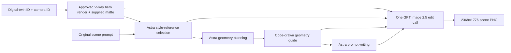
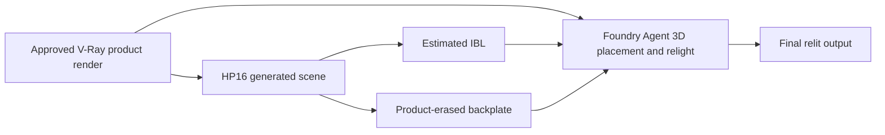

# HP image-pipeline access and code map

Verified on 2026-11-04.

## Result

The image-only endpoint works. `POST /api/generate` produced a 2368×1776 PNG from the requested Cashmere digital twin, `Front_CloseUp` camera, and scene prompt. It made one GPT Image call and skipped the downstream IBL, backplate, recomposite, and 3D-relight stages.

The live endpoint uses the same Foundry scene-generation code lineage as PR 4261, but it is not running the current PR 4261 head. Runtime provenance identifies PR 4256, commit `4d685d95cb8790da4a464a659892b792a0c96d9c`, pipeline `unified-blue-scale-v16`. PR 4261 currently resolves to `40b39286d932235c35ec9ef8f0dcd2ccb296b0a2`, pipeline `unified-blue-scale-v17-plain-geometry`.

Treat the endpoint as the immediate V16 predecessor of PR 4261 until it reports the V17 commit in `/api/catalog` and per-job status.

The page badge still names Foundry PR 4121. That static label conflicts with the more specific live catalogue and per-job debug records, so the catalogue/job provenance is authoritative for evaluated runs.

## API

Base URL:

`https://pluto-prod-dongshenga-dylan-hp-new-9nmp4k-2-0-8016.or2.colligo.dev`

| Route | Purpose |
|---|---|
| `GET /api/credentials` | Establish a browser/session cookie and obtain the CSRF token. |
| `GET /api/catalog` | List available digital twins, cameras, reference count, generator, and deployed rewriter lineage. |
| `POST /api/generate` | Generate only the scene image. The OpenAPI description explicitly says downstream E2E stages and their credentials are not used. |
| `POST /api/run` | Run the full pipeline. |
| `GET /api/jobs/{job_id}` | Poll status and obtain stage/debug metadata. |
| `GET /api/jobs/{job_id}/artifacts/{filename}` | Download a stage artifact. The scene image is `2_scene.png`. |
| `GET /openapi.json` | Live route inventory. |

The checked-in smoke client is `generate_scene_smoke.sh`. It performs one submission, saves the resumable status URL immediately, polls without resubmitting, verifies that only `hero` and `scene` completed, and hashes the downloaded image.

## Image-only scene pipeline



The live run reported:

- Text model: `gpt-6-astra`.
- Image model: `gpt-image-2.5-sunburst-2026-09-08`.
- Original user request only; no upstream HP12 or Gemini rewrite.
- One selected HP style reference.
- Two Astra stages: structured geometry first, then camera/composition/image-prompt writing after the guide is drawn.
- One masked GPT Image edit call.
- No grading, resizing, automatic image repair, or product pixel lock. Product preservation is model-guided.

This is not a raw prompt-to-image pass. Astra rewrites the original scene request around fixed product geometry and the selected HP reference. Both V16 and V17 also apply a default prominent-physical-blue policy when the input does not specify a blue preference; explicit minimal-blue, carrier, amount, or no-blue instructions override that default. In the smoke run, Astra added a broad dusty-blue tiled wall because the short café prompt left blue unspecified.

Every judge record should therefore retain the original user prompt, selected reference, geometry response/guide metadata, Astra writing response, final GPT Image prompt, scene output, and runtime versions. Judging only the original prompt against the image would hide material instructions introduced inside the generation pipeline.

## Full endpoint pipeline



`POST /api/run` exercises the full path. A read-only inspection of successful job `20261103T235048Z_822e8314` found `hero`, `scene`, `ibl`, `backplate`, and `relight` complete; `recomposite` was skipped. Runtime metadata identifies V-Ray placement and Foundry Agent 3D relighting. The downstream wrapper implementation is not in PR 4261, so its internal algorithms should not be inferred from the PR.

The UI states that scene generation does not use Gemini or IMS. HDRI/3D relighting uses an automatically refreshed server IMS token, cached approved product assets, and server-managed V-Ray. This is why `/api/generate` worked even while the endpoint reported expired S3D and missing AWS credentials for downstream work.

## Foundry source code

Repository: `git@github.com:Adobe-Firefly/foundry.git`

PR: https://github.com/Adobe-Firefly/foundry/pull/4261

PR 4261 head at audit time:

`40b39286d932235c35ec9ef8f0dcd2ccb296b0a2`

Code package:

`experimental/adarabi/hp-3p-gpt25`

Key files at the audited commit:

- `hp3p/pipeline.py`: scene orchestration, reference selection, Astra stages, guide construction, final prompt, and one image call.
- `hp3p/openai_client.py`: `gpt-6-astra` JSON calls and the GPT Image 2.5 `images.edit` call.
- `hp3p/geometry.py`: geometry schema, guide construction, bounds/contact, and camera/support calculations.
- `hp3p/mask.py`: standalone CLI mask preparation. The endpoint reports a supplied matte, showing that its wrapper injects a better product mask.
- `hp3p/catalog.py`: deterministic reference selection after Astra chooses tone/content.
- `hp3p/cli.py`: standalone research CLI.
- `README.md`, `CONTEXT.md`, and `docs/REPRODUCING.md`: operational contract and limitations.

Pinned source links:

- https://github.com/Adobe-Firefly/foundry/blob/40b39286d932235c35ec9ef8f0dcd2ccb296b0a2/experimental/adarabi/hp-3p-gpt25/hp3p/pipeline.py
- https://github.com/Adobe-Firefly/foundry/blob/40b39286d932235c35ec9ef8f0dcd2ccb296b0a2/experimental/adarabi/hp-3p-gpt25/hp3p/openai_client.py

To inspect the exact PR head without keeping another Git checkout in this project:

```bash
mkdir -p /mnt/localssd/hp_lifestyle_pipeline/foundry_pr4261
git -C /mnt/localssd/hp_lifestyle_pipeline/foundry_pr4261 init
git -C /mnt/localssd/hp_lifestyle_pipeline/foundry_pr4261 remote add origin git@github.com:Adobe-Firefly/foundry.git
git -C /mnt/localssd/hp_lifestyle_pipeline/foundry_pr4261 fetch --depth=1 origin refs/pull/4261/head:refs/remotes/origin/pr4261
git -C /mnt/localssd/hp_lifestyle_pipeline/foundry_pr4261 checkout --detach refs/remotes/origin/pr4261
```

## V16 versus PR 4261 V17

PR 4261 is stacked on the live endpoint's V16 commit. Its material scene-generation changes are:

- Remove `scale_plan` from the Stage-A response and validation.
- Keep Stage A focused on geometry and product category.
- Have Stage B translate numeric guide geometry into a plain-language `layout` for GPT Image.
- Change the policy identifier from `unified-blue-scale-v16` to `unified-blue-scale-v17-plain-geometry`.

The scene architecture and single GPT Image call remain the same. Judge runs must record `rewriterVersion`, `pipelineVersion`, `textModel`, and `imageModel` for every generation so results from V16 and V17 are never mixed silently.

## Smoke evidence

Job: `20261104T221609Z_7e243085`

Status: https://pluto-prod-dongshenga-dylan-hp-new-9nmp4k-2-0-8016.or2.colligo.dev/api/jobs/20261104T221609Z_7e243085

Scene artifact: https://pluto-prod-dongshenga-dylan-hp-new-9nmp4k-2-0-8016.or2.colligo.dev/api/jobs/20261104T221609Z_7e243085/artifacts/2_scene.png

The output visibly contains the requested laptop on a warm wooden café table beside a window. That confirms request execution, not product fidelity or overall image acceptance; those are future judge dimensions.

Durable evidence is under `smoke_runs/20261104T221609Z_7e243085`. The 4.59 MB PNG and polling history remain in volatile scratch storage at:

`/mnt/localssd/hp_lifestyle_pipeline/judge_endpoint_smoke/20261104T221609Z`
