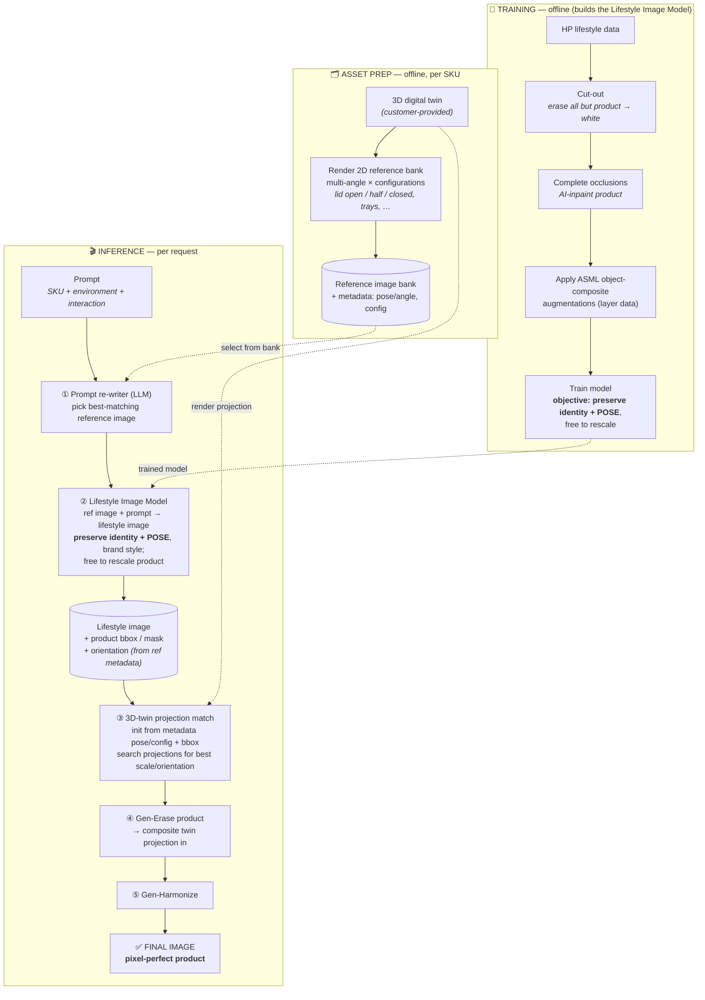

# HP Lifestyle Image Generation Pipeline

**Proposal from Foundry**
**Prepared by Hooman Shariati**

**Goal:** From a product SKU and a text prompt, generate a lifestyle image of that product in
use — where the product in the final image is **pixel-perfect** (true to the 3D digital twin),
correctly posed, correctly styled to HP brand guidelines, and naturally composited into the scene.

**Key idea:** an AI model generates the *scene and approximate product placement*, but the final
product pixels are a **projection of the 3D digital twin** composited back in — so identity is
guaranteed by construction, not left to the generative model.

---

## Block Diagram

---

> **Phase 1 scope:** For this phase we narrowed the problem to a **closed, enumerated set of
> orientations and configurations, agreed with the customer.** This makes step ② easier for the
> model (it only has to preserve a known set of poses) and makes step ③ tractable (the projection
> match becomes a local refinement around a known configuration, rather than continuous 6DOF pose
> estimation from a single image). These limitations can be addressed in later phases.

---

## How We Will Build the Lifestyle Image Model (step ② in the diagram)

We will train an image model that takes the reference image and the prompt and generates the
lifestyle image output. The output image will have the correct style (i.e. brand guidelines,
"blueness," etc.). It will try to **preserve the identity** of the reference image. Most
importantly, it will try to keep the **pose** of the reference image consistent: the model will
not dramatically rotate the reference image, and the product in the output image will have the
same orientation as the reference image, as much as possible. However, the model **is** free to
change the **scale** (size) of the product to fit the lifestyle image.

> **Note:** the generative image model, as trained today, does not optimize for matching the
> orientation of the reference image. Pose consistency is a new objective we are adding.

**Plan for creating this model:**

**1. Cut-outs.** Using the current HP data, we will do cut-outs. Basically, we will erase
everything from the lifestyle image other than the product, so everything else will be replaced
with white pixels.

**2. Complete the cut-out (i.e. generate the occlusions).** This is because the product from
the lifestyle image will have occlusions, so we will need AI to complete it.

**3. Bring in the object-composite dataset from ASML.** We will explore and understand all of
the augmentations so that we do the same here.

**4. Apply the ASML augmentations.** We will apply all of the augmentations that ASML did for
object composite (layer data) on our data.

---

## 3D-Twin Projection Match & Compositing (steps ③–⑤ in the diagram)

Once the Lifestyle Image Model has produced the output image, this stage swaps the generated
product for a pixel-perfect 2D projection of the 3D digital twin, and then blends it into the
scene. The inputs come directly from the previous step: for this output image, we will have the
**bounding box** of the product (and the **mask** if needed), as well as the **orientation**,
etc. — which comes from the metadata of the reference image.

**Plan for this stage:**

**1. Create the best-matching 2D projection from the digital twin (step ③).** The goal of this
stage is to create a 2D projection from the 3D digital twin that best matches the product in the
lifestyle image. There will be an initial input for the orientation and configuration that comes
from the metadata of the reference image, as well as the bounding box / mask. So we can
potentially generate different projections and find the best match for scale / orientation. There
are other algorithms that can be explored here.

**2. Gen-erase and replace (step ④).** Next, the product is removed from the lifestyle image
(using gen-erase) and is replaced by the 2D projection coming from the digital twin.

**3. Gen-harmonize (step ⑤).** Finally, we run gen-harmonize to harmonize the image.

---

## What's Needed from the Partner Teams

Our team is essentially responsible for **only the Lifestyle Image Model** (step ② and its
training). The rest of the pipeline is owned by partner teams:

- **3D digital twins** — provided by the customer (HP), one per SKU.
- **Reference-bank generation** (ASSET PREP lane) — automated rendering of the 2D reference bank
  from each twin, at the agreed set of angles / configurations, with per-image metadata (pose /
  angle, configuration).
- **Align with the customer on the closed set** of angles / poses / configurations that we are
  limiting the Phase 1 solution to.
- **3D-twin projection match (③)** — rendering the best-matching 2D projection of the twin from the
  metadata + bounding box / mask.
- **Gen-erase + composite (④)** and **Gen-harmonize (⑤)** — existing pipelines; they just need to
  be called (no new build).

---

## Risks

1. **Pose adherence (step ②).** The lifestyle image model might not be fully honoring the pose of
   the reference image, given that it has a competing requirement of adhering to the prompt. This
   is why we are still investing in the 3D-twin projection match (step ③).
2. **Projection-match accuracy (step ③).** We are not sure how accurate the projection match
   (step ③) will be — that's why we are investing in the lifestyle image model (step ②).
3. **Harmonization drift (step ⑤).** There is some risk that gen-harmonize (step ⑤) might affect
   the identity of the product, but we are hoping this will be OK.
