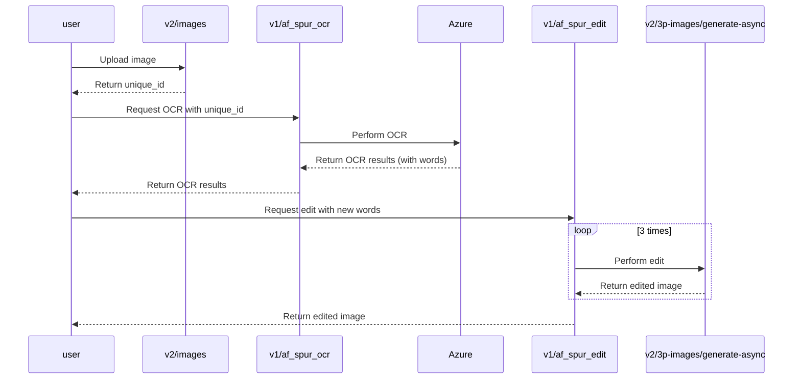

# AF Spur

Async Endpoints for detection and editing of text within images.



## Setup

`af_spur` uses a custom Python environment (`af_spur`) due to its dependency on a specific version of `transformers` and `flash-attn` that conflict with the default `dev` env.

### 1. Enable and create the custom environment

```bash
./m deps.enable af_spur
./m deps.create --env af_spur
```

### 2. Lock dependencies (Linux only)

Only needed when changing `envs/af_spur/constraints.txt`. Lock files must be generated on Linux because the environment includes CUDA-dependent wheels (`flash-attn`).

```bash
./m deps.lock --env af_spur
```

On macOS, use the Docker-based locker instead (requires Docker Desktop and `ARTIFACTORY_UW2_API_TOKEN`):

```bash
./m deps.lock.docker --env af_spur
```

After locking, commit the updated `requirements.lock.txt`, `known-packages.txt`, and `linter-roots.txt`.

### 3. Set the Python interpreter for local rhode development

When running rhode locally (VSCode debugger), you must point the Python interpreter at the `af_spur` venv rather than the default `dev` venv:

- **VSCode**: Python: Select Interpreter → Enter interpreter path → `./.venvs/af_spur/bin/python`

This is required because the worker's `colligo.yaml` declares `custom_pyenv: af_spur`, so the rhode supervisor will launch the worker process using `.venvs/af_spur/bin/python`. Mismatching the interpreter causes import errors for packages only present in the `af_spur` env (e.g. `af_spur`, `flash-attn`).

### Linting

Because the package uses a custom env, run the linter with the `--paths` flag to avoid mypy falling back to the wrong environment:

```bash
./m lint --paths "models/colligo/models/af_spur"
```
