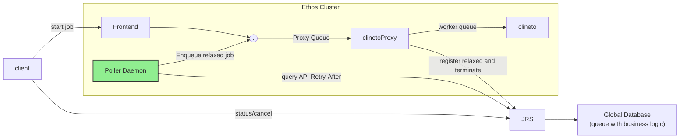

# Relaxed Mode Daemon

## Files

- `daemon_supervisor.py` : This one is extra supervisor for relaxed daemon (https://jira.corp.adobe.com/browse/FFP-34011).
- `__main__.py`: The entrypoint that is invoked by the supervisor.
- `config.py` : The config for relaxed daemon.
- The other files are used in `__main__.py`, see their docstring.


## How does it work

This daemon is written for https://jira.corp.adobe.com/browse/FFP-34011

The main entry point is the supervisor [colligo/models/firefly/service_common/relaxed_mode_daemon](/models/colligo/models/firefly/service_common/relaxed_mode_daemon/) for both local development and launching in k8s. The supervisor ensures all python deps are downloaded, and then starts the worker.

The high level is captured in this graph:



Followed [Advanced worker template](/models/colligo/models/template/t2/advanced/)

The supervisor and worker are separate packages, because we include supervisor as the startup env, and we want it to be light.

## Running it

### Run in dev mode

* Command line: `python -m colligo.models.firefly.service_common.relaxed_mode_daemon.daemon_supervisor`
* Vscode: Launch Relaxed Mode Daemon

In this case, the status and metrics start separately and go to ports 9001-9002 to not interfere with the inference server ports.

You can launch inference server separately. They go to their usual 8000-8003 ports.

### Run with init script

1. Follow the usual aidoc/inference-platform/tutorials/serve.md#Debugging the init script for the relaxed daemon worker.  The relaxed daemon worker has its own init script with the application name as `relaxed_daemon`.

2. Replace with last step with:
```
python -m colligo.models.firefly.service_common.relaxed_mode_daemon.daemon_supervisor --worker-config "<JSON_STRIGIFIED_RELAXED_DAEMON_CONFIG>"
```

Please replace `<JSON_STRIGIFIED_RELAXED_DAEMON_CONFIG>` with the JSON stringified config for the relaxed daemon worker. For e.g. - 
```
{\"application_id\":\"ff-gen-video-persistence-dev\",\"jobs_per_iteration\":1000,\"video_service_url\":\"https://clineto-persistence-dev.ethos851-stage-or2.ethos.adobe.net\",\"pipeline_worker_name\":\"clineto_pipeline\"}
```
Refer to [Configuration](#Configuration) for relaxed daemon worker config.

### Serve in Ethos

You need to override the startup command to be (via `worker.command`)
```
python -m colligo.models.firefly.service_common.relaxed_mode_daemon.daemon_supervisor --worker-config {{ .worker.config | toJson | toString | quote }}
```

## Advanced interactions

### Dependencies

The daemon pulls the same dependencies as the pipeline and its workers.

### Configuration

The relaxed daemon worker uses the configuration `RelaxedModeDaemonConfig` class in order to enable the relaxed mode daemon. 

Configuration is read from the relaxed worker config. You can set and override this the same way (helm chart) you deal with the rest of the configuration. E.g. in deploy config


# in colligo-deploy for the app that wants the daemon
```yaml
workers:
  ...
  relaxed_daemon:
    init_script: ... # will have its own init script
    replicas: 1
    command: "colligo.models.firefly.service_common.relaxed_mode_daemon.daemon_supervisor --worker-config {{ .worker.config | toJson | toString | quote }}"
    config:
      application_id: ff-gen-video-persistence-dev
      jobs_per_iteration : 2
      pressure_threshold: 10
      pressure_avg_window_s: 60
      pressure_min_data_points: 2
      sleep_time_s: 30
      pipeline_worker_name: clineto_pipeline
      video_service_url: https://clineto-persistence-dev.ethos851-stage-or2.ethos.adobe.net
```

### Turn on and off

The daemon offers a API to turn it on and off globally. It will be hosted on port 8000 in ethos (and 9000) when developing.

Example: <https://gen-video-rmd-colligov2-dev.corp.ethos851-stage-or2.ethos.adobe.net/>