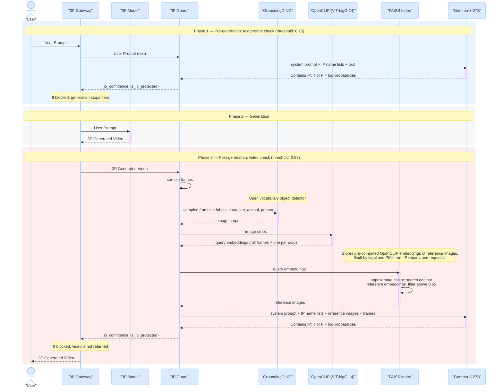

# IP Guard Pipeline Worker

Multi-modal AI pipeline for detecting intellectual property violations in text, images, and videos.

## Overview

The IP Guard pipeline orchestrates detection, retrieval, and VLM-based analysis to identify protected IP (characters, famous names, logos) in generated content or user prompts. It supports three input modalities:

1. **Text-only** (pre-generation): Analyzes text prompts before content generation
2. **Text + Image** (post-generation): Analyzes generated images for IP violations
3. **Text + Video** (post-generation): Analyzes generated videos frame-by-frame

## Architecture

The diagram below shows the full lifecycle of a user request through IP Guard: pre-generation text screening, third-party video generation, and post-generation video analysis.



### Phase summary

| Phase | Trigger | Model | Decision threshold |
|-------|---------|-------|--------------------|
| 1 — Text check | Every request | Gemma-3-27B | 0.75 |
| 2 — Generation | Phase 1 passes | 3P Model | — |
| 3 — Video check | Generation completes | GroundingDINO + OpenCLIP + Gemma-3-27B | FAISS pre-filter: 0.65 · Final VLM: 0.95 |

### Component roles

- **GroundingDINO** — open-vocabulary object detector; isolates candidate crops (characters, animals, persons) from sampled frames before embedding.
- **OpenCLIP (ViT-bigG-14)** — encodes both query crops and the reference image library into a shared embedding space for similarity search.
- **FAISS Index** — stores pre-computed OpenCLIP embeddings of known IP reference images, curated by legal and PMs. Approximate cosine search filters candidates above 0.65 before passing to the VLM.
- **Gemma-3-27B** — final arbiter in both phases; returns a binary IP classification and log-probabilities used to derive `ip_confidence`.

## API Usage

### Request Format

```python
from colligo.models.ip_guard.worker.pipeline.types import (
    IPGuardRequest,
    IPGuardModerationSets,
)

# Text-only (pre-generation)
request = IPGuardRequest(
    text="Generate an image of Mickey Mouse with Nike logo",
)

# Text + Image (post-generation)
request = IPGuardRequest(
    image="https://example.com/generated-image.jpg",  # or PublicBinary or Tensor
)

# Text + Video (post-generation)
request = IPGuardRequest(
    video="https://example.com/video.mp4",  # or PublicBinary or Tensor
)

# With allowed reference images (exceptions)
request = IPGuardRequest(
    text="Generate our company mascot",
    image="https://example.com/generated.jpg",
    allowed_reference_images=[
        "https://example.com/our-mascot.jpg"  # Won't be flagged as IP
    ],
)
```

### Response Format

```python
from colligo.models.ip_guard.worker.pipeline.types import IPGuardResponse

response = IPGuardResponse(
    ip_confidence=0.95,  # Confidence score (0-1)
    vllm_response={
        "is_ip_protected": True,  # Boolean flag
        "reasoning": "The image contains Mickey Mouse...",  # Optional
        "raw_response": "<reasoning>...</reasoning>T",
    },
    metadata={
        "model_name": "google/gemma-3-27b-it-FP8-Dynamic",
        "pipeline": "text_image",
        "wall_time_seconds": {...},  # Timing breakdown
        "preprocessor": {...},
        "retrieval": {...},
        "detection": {...},
        "postprocessor": {...},
    },
    debug_data=None,  # Only populated when debug mode enabled
)
```

## Configuration

### Request-time Config Overrides

Via `x-colligo-debug-input` header:

```python
# Enable debug mode
debug_data = {
    "ip_guard_debug": True
}

# Override moderation set
debug_data = {
    "ip_guard_override_moderation_set": ["Custom IP 1", "Custom IP 2"]
}

# Override system prompt
debug_data = {
    "ip_guard_override_system_prompts": {
        "text_only": "Custom system prompt..."
    }
}

# Override config parameters
debug_data = {
    "config_override": {
        "ip_confidence_pre_gen_threshold": 0.5,
        "retrieval_config": {
            "enable_retrieval": False
        }
    }
}
```

## Features

### 1. Pre-generation vs Post-generation Modes

**Pre-generation (text-only):**
- Analyzes text prompts before content generation
- Lower confidence threshold (0.75) - more sensitive
- No RAG retrieval (no image to search)
- Faster response time (~800ms-1.5s)

**Post-generation (image/video):**
- Analyzes generated content after creation
- Higher confidence threshold (0.95) - more precise
- Includes RAG retrieval for visual similarity matching
- Slower response time (~1.5-5s depending on modality)

### 2. Video Processing

**Frame Sampling:**
- Samples frames evenly across video duration
- Default: 3 frames (`max_sampled_frames=3`)
- Configurable per request
- Each text prompt maps to a shot in the output video; the pipeline
  automatically increases `max_sampled_frames` to `num_prompts + 1`
  when the prompt count meets or exceeds the configured value, increasing
  the sampling budget to improve per-shot coverage (capped at max shots + 1 to bound resource usage)

**Frame Deduplication:**
- Uses perceptual hash (pHash) to detect similar frames
- Default threshold: 0.3 (moderate deduplication)
- Frames with pHash difference ≤ threshold are removed
- Reduces inference cost without sacrificing accuracy

### 3. Guided Decoding

**Reasoning Mode (`do_reasoning=True`):**
- Output format: `<reasoning>...</reasoning>T/F`
- Provides explanation for detection decision
- Slower but more interpretable
- Better for debugging and audit trails

**Fast Mode (`do_reasoning=False`):**
- Output format: `T` or `F`
- No explanation, just boolean flag
- Faster and cheaper
- Better for production at scale

Both modes return logprobs for confidence calculation.

### 4. Moderation Sets

**Available Sets:**
- `CHARACTERS` - Fictional and copyrighted character names
- `FAMOUS_NAMES` - Real people and celebrity names
- `LOGOS` - Brand logos
- `ADAPTIVE` - Dynamically inserted on top of the other post-sorted sets

**Multiple sets can be merged** by configuring `IPGuardConfig` at the worker level:

```python
# In worker/pipeline/build.py
worker_config = IPGuardConfig(
    moderation_sets=[
        IPGuardModerationSets.CHARACTERS,
        IPGuardModerationSets.LOGOS,
    ],
)
```

**Storage:**
- Moderation sets are checked into git for reference only
- The actual worker sources the authoritative versions at runtime from S3
- Can be overridden via debug headers

### 5. RAG Retrieval (Optional)

**When enabled:**
1. Optionally detect IP-related objects in image (GroundingDINO)
2. Crop detected regions or use full image
3. Encode crops/images with DinoV2/V3
4. Search FAISS index for similar reference characters
5. Return top-k similar references with metadata

**Configuration:**
```python
retrieval_config = RetrievalConfig(
    enable_retrieval=True,
    retrievals_per_query=3,  # Per query image/crop
    max_total_references=3,   # Total sent to VLM after dedup
    similarity_threshold=0.75,  # Min similarity score
)
```

**Detection (optional within retrieval):**
```python
detection_config = DetectionConfig(
    enable_detection=True,
    labels=["character", "logo", "person"],
    detection_confidence_threshold=0.3,
)
```

### 6. Confidence Calculation

**Algorithm:**
1. Extract logprobs from VLM response
2. Find True/False token probabilities
3. Calculate: `confidence = P(True) / (P(True) + P(False))`
4. Apply temperature scaling for calibration

**Temperature Scaling:**
- Default: `temperature=5.0`
- Higher temperature → more conservative (spreads toward 0.5)
- Lower temperature → more confident (polarizes toward 0/1)

### 7. Allowed Reference Images

Explicitly allowed IP that should **not** be flagged:

```python
request = IPGuardRequest(
    text="Generate our company mascot",
    image="https://example.com/generated.jpg",
    allowed_reference_images=[
        "https://example.com/our-official-mascot.jpg"
    ],
)
```

Use cases:
- Company-owned IP
- Licensed IP for specific use
- Parody/fair use exceptions

## Debug Mode

Enable via `x-colligo-debug-input: {"ip_guard_debug": true}`

**Response includes:**
- `debug_data.detections` - Raw detection results with bounding boxes
- `debug_data.detection_visualizations` - Images with boxes drawn
- `debug_data.rag_queries` - Images used for RAG queries
- `debug_data.rag_references` - Full RAG results with similarity scores
- `debug_data.sampled_video_frames` - Extracted video frames (video only)
- `debug_data.sampled_video_frame_indices` - Frame indices (video only)
- `debug_data.config` - Full config used for request

**Use cases:**
- Debugging false positives/negatives
- Understanding RAG retrieval behavior
- Analyzing detection quality
- Tuning confidence thresholds

## Testing

```bash
# All pipeline tests
pytest models/colligo/models/ip_guard/tests/test_ip_guard_worker.py

# Integration tests
pytest models/colligo/models/ip_guard/tests/test_integration.py

# With debug output
pytest models/colligo/models/ip_guard/tests/ -v -s
```

## Related Documentation

- [Detection Worker](../detection/README.md) - GroundingDINO object detection
- [Retrieval Worker](../retrieval/README.md) - FAISS-based RAG retrieval
- [Overview](../../aidoc/overview.md) - Detailed architecture documentation
- [Configuration](../../aidoc/configuration.md) - Extension and configuration guide