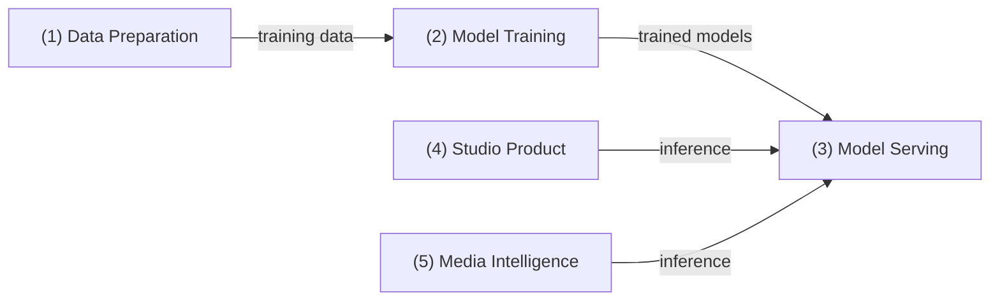

# Foundry

The home base for every Foundry engineer. This repo contains the Studio Product, Media Intelligence, modeling infrastructure, experimental work, and — most importantly — the documentation that ties the whole org together. Some code naturally lives elsewhere: training in [`foundation_exploration`](https://github.com/Adobe-Firefly/colligo/tree/main/contrib/Mori/collections/foundation_exploration) (colligo), data pipelines in [`genie`](https://github.com/Adobe-Firefly/genie), and inference services in [`colligo`](https://github.com/Adobe-Firefly/colligo). But this is where you start.

Agent-readable docs live in `docs/` — open Claude Code or Cursor here and ask what you need. The [Foundry wiki](https://wiki.corp.adobe.com/x/YDwA0g) holds project progress, experiments, and PgM-owned processes. For best results, give your agent wiki access too: generate a [Confluence personal access token](https://wiki.corp.adobe.com/plugins/personalaccesstokens/usertokens.action) — that's often enough on its own, but for the best experience use a wiki MCP (e.g. via [EasyMCP](https://docs.easymcp.pages.adobeitc.com/#/installation?id=quick-install)).

## 1. Org Overview

| # | Work Area | Code Lives In | Overview Doc |
|---|---|---|---|
| 1 | Data Preparation | Glimmer ([`genie`](https://github.com/Adobe-Firefly/genie)), ad-hoc ([`experimental/`](experimental/)), [CaptionLens](experimental/miranda/foundry-captionlens) | [`docs/data-processing.md`](docs/data-processing.md) |
| 2 | Model Training | foundation_exploration ([`colligo`](https://github.com/Adobe-Firefly/colligo)) | [`docs/training.md`](docs/training.md) |
| 3 | Model Serving | v2: gen-foundry ([`colligo`](https://github.com/Adobe-Firefly/colligo) + [`colligo-deploy`](https://git.corp.adobe.com/firefly/colligo-deploy)); v3: managed services ([`colligo/managed_services`](https://github.com/Adobe-Firefly/colligo/tree/main/managed_services)) | [`docs/inference-overview.md`](docs/inference-overview.md) |
| 4 | Studio Product | `foundry-studio/` (this repo) | [`foundry-studio/README.md`](foundry-studio/README.md) |
| 5 | Media Intelligence | `media-intelligence/` (this repo) | [`media-intelligence/README.md`](media-intelligence/README.md) |

## 2. Reference Docs

Cross-cutting docs that span multiple work areas. For work-area-specific docs, see the "Overview Doc" column in §1.

| # | Title | Doc | Related To |
|---|---|---|---|
| 1 | Compute Jobs | [`docs/compute-jobs.md`](docs/compute-jobs.md) | (2) Model Training, (1) Data Preparation |
| 2 | Project Setup & Access | [`docs/project-setup-and-access.md`](docs/project-setup-and-access.md) | All — cloud resources and auth |
| 3 | Third-Party Models | [`docs/third-party-models.md`](docs/third-party-models.md) | (1) Data Preparation, (2) Model Training, (3) Model Serving |
| 4 | Inference Services — v2 (gen-foundry) | [`docs/inference-services-v2.md`](docs/inference-services-v2.md) | (3) Model Serving |
| 5 | Inference Services — v3 (managed services / standalone apps) | [colligo `aidoc/inference-services-v3.md`](https://github.com/Adobe-Firefly/colligo/blob/main/managed_services/services/firefly/foundry/aidoc/inference-services-v3.md) | (3) Model Serving |
| 6 | Gen-Foundry Runbook | [`docs/gen-foundry-runbook.md`](docs/gen-foundry-runbook.md) | (3) Model Serving |
| 7 | Board Plugins | [`experimental/shared/boards/README.md`](experimental/shared/boards/README.md) | (3) Model Serving |
| 8 | AWS Gateway | [docs.ai (foundry AWS gateway)](https://docs.ai.corp.adobe.com/managed_services/services/firefly/foundry/apps/aws_gateway/README.html) | (1) Data Preparation, (2) Model Training, (3) Model Serving |
| 9 | Documentation Rules | [`docs/documentation-rules.md`](docs/documentation-rules.md) | All — where docs live and how to structure them |
| 10 | Common Issues | [`docs/common-issues.md`](docs/common-issues.md) | All — known gotchas and their fixes |
| 11 | Floodgate (Feature Flags & Audiences) | [`docs/floodgate.md`](docs/floodgate.md) | (4) Studio Product — feature flags and audience management |
| 12 | Gen-Foundry Auth & Allowlisting | [`docs/gen-foundry-auth-allowlisting.md`](docs/gen-foundry-auth-allowlisting.md) | (3) Model Serving — API auth layers and customer onboarding |
| 13 | Claude Code Plugins | [`.claude/plugins/README.md`](.claude/plugins/README.md) | All — internal plugin marketplace of shared agent skills (e.g. panel-review) |

## 3. This Repo

| Folder | Description |
|---|---|
| `docs/` | Live reference docs — agents and developers may read these |
| `experimental/` | Staging ground for nascent ideas and prototypes |
| `foundry-studio/` | Studio Product — NestJS backend, Lit frontend, Colligo contracts, Terraform |
| `media-intelligence/` | Video understanding pipeline — ML inference, search API, data processing |
| `modeling/` | Shared modeling infrastructure; Terraform for modeling storage |
| `plans/` | Historical planning artifacts — for reference only, not maintained |
| `tools/` | Repo-internal tooling — Claude Code plugin marketplace of shared agent skills |

> [!CAUTION]
> Do not add new top-level folders without discussing with the global repo owners in [`.github/CODEOWNERS`](.github/CODEOWNERS).

## 4. External Resources

| Resource | Purpose |
|---|---|
| [Foundry Wiki](https://wiki.corp.adobe.com/x/YDwA0g) | Project progress, experiment results, planning docs, PgM-owned processes |
| [Jira (FFP)](https://jira.corp.adobe.com/projects/FFP) | Issue tracking and sprint planning |

See `AGENTS.md` for agent conventions (git workflow, package guidelines, how to read this repo).
