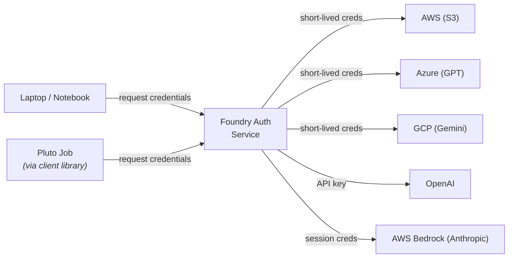

# Cloud Resources and Access Management

<!--TOC-->

- [1. Overview](#1-overview)
  - [1.1 Resource Map](#11-resource-map)
  - [1.2 Access Tiers](#12-access-tiers)
- [2. Developer Guide](#2-developer-guide)
  - [2.1 Getting Access](#21-getting-access)
  - [2.2 How Credentials Work](#22-how-credentials-work)
  - [2.3 AWS (S3 Buckets)](#23-aws-s3-buckets)
  - [2.4 Azure OpenAI](#24-azure-openai)
  - [2.5 OpenAI (Direct)](#25-openai-direct)
  - [2.6 GCP (Gemini)](#26-gcp-gemini)
  - [2.7 Restricted GitHub Repos](#27-restricted-github-repos)
  - [2.8 Ethos Services: LLM Access via Vault Secrets](#28-ethos-services-llm-access-via-vault-secrets)
  - [2.9 IMS Clients (Service Identity)](#29-ims-clients-service-identity)
  - [2.10 Need Something Else?](#210-need-something-else)
- [3. Admin Guide](#3-admin-guide)
  - [3.1 Accounts Inventory](#31-accounts-inventory)
  - [3.2 Access Groups](#32-access-groups)
  - [3.3 Restricted GitHub Repos](#33-restricted-github-repos)
  - [3.4 Cloud Resource Management](#34-cloud-resource-management)
  - [3.5 Long-Lived Service Credentials (Vault)](#35-long-lived-service-credentials-vault)
  - [3.6 Floodgate (Feature Flags & Audiences)](#36-floodgate-feature-flags--audiences)

<!--TOC-->

## 1. Overview

This doc covers Foundry's cloud resources — what we have, how developers use them, and how admins manage them.

### 1.1 Resource Map

| Resource | What It's For | Developer Guide | Admin Guide |
|---|---|---|---|
| **AI Compute Platform (Pluto)** | GPU jobs for training and data processing | [`docs/compute-jobs.md`](compute-jobs.md) | [Foundry Initiative](https://ai.corp.adobe.com/compute/initiatives/d54f60e2-523d-4314-a8dc-885f091183f6) (managed in Pluto UI) |
| **AWS S3** | Project data (training data, model artifacts, eval results) | [§2.3](#23-aws-s3-buckets) | [§3.4](#34-cloud-resource-management) |
| **Azure OpenAI** | GPT endpoints | [§2.4](#24-azure-openai) | [§3.4](#34-cloud-resource-management) |
| **OpenAI (direct)** | OpenAI platform endpoints | [§2.5](#25-openai-direct) | [§3.1](#31-accounts-inventory) |
| **AWS Bedrock (Anthropic)** | Claude models (data processing, eval) | [§2.6a](#26a-aws-bedrock-anthropic) | [§3.4](#34-cloud-resource-management) |
| **GCP** | Gemini endpoints | [§2.6](#26-gcp-gemini) | [§3.4](#34-cloud-resource-management) |
| **GitHub (restricted repos)** | Code access control for Foundry-only repos | [§2.7](#27-restricted-github-repos) | [§3.3](#33-restricted-github-repos) |
| **Vault** | Long-lived service credentials for Ethos deployments | [§2.8](#28-ethos-services-llm-access-via-vault-secrets) | [§3.5](#35-long-lived-service-credentials-vault) |

**Where to go:**
- **Developer?** Start at [§2 — Developer Guide](#2-developer-guide) (getting access, using resources).
- **Admin?** Jump to [§3 — Admin Guide](#3-admin-guide) (accounts, groups, infrastructure).

### 1.2 Access Tiers

We use two tiers of access, managed via IAM umbrella groups:

- **Foundry-Developer** — all Foundry engineers. Readonly access to cloud accounts. Also grants membership in the [`foundry-github-contributors`](https://github.com/orgs/Adobe-Firefly/teams/foundry-github-contributors) GitHub team for restricted repos ([§2.7](#27-restricted-github-repos)).
- **Foundry-Developer-Admin** — a small group (capped at max 6 people) with full account access for administration.
   > Current administrators are Hooman Shariati, Shayan Hoshyari, Marian Petre, Eugene Brodskey.

---

## 2. Developer Guide

### 2.1 Getting Access

To use Foundry cloud resources, you need three things:

1. **Subscribe to Colligo Developer** — this grants access to the higher-level compute platform. Follow the instructions at [Colligo Access Control](https://docs.ai.corp.adobe.com/aidoc/access-control.html).
2. **Join the Foundry-Developer group** — this grants read-only access to all cloud accounts plus write access for S3, Gemini, and OpenAI. Request membership via **Access → Request** at [iam.corp.adobe.com](https://iam.corp.adobe.com).

   > [!WARNING]
   > **Do NOT request Foundry-Developer-Admin.** Admin membership is restricted to a small group (4–5 people) to prevent accidents.

   <details>
   <summary>📷 Screenshot</summary>

   

   </details>

   After requesting, ping one of the approvers to get approved: Ajinkya Kale, Hooman Shariati, Purvak Lapsiya, Eugene Brodsky, Vova Kim, Soheil Darabi.

3. **Be added to at least one Foundry project** — project membership determines which data and resources you can access. Ask a project or initiative admin to add you via the [Foundry Initiative on Pluto](https://ai.corp.adobe.com/compute/initiatives/d54f60e2-523d-4314-a8dc-885f091183f6) (admins are shown in the Pluto UI).

### 2.2 How Credentials Work

Developers need more than readonly access — they write to S3, call LLM APIs, etc. But admin-level access is too broad. We solve this with **short-lived credentials**.

The **[Foundry Auth Service](https://foundry-aws-corp.adobe.io/)** vends credentials (12-hour expiry) scoped to exactly the write operations developers need. Client libraries (e.g. [`foundry_aws_gateway`](https://docs.ai.corp.adobe.com/managed_services/services/firefly/foundry/libs/aws_gateway_client/README.html)) handle retrieval and refresh transparently. You use them from two contexts:

1. **Interactive (laptop / notebook)** — exploring data, running evals, calling LLM APIs.
2. **Long-running jobs (Pluto)** — training and data-processing jobs that may run for hours or days.



### 2.3 AWS (S3 Buckets)

AWS credential vending is **fully implemented**.

#### 2.3.1 Getting Credentials (Manual Use)

Go to https://foundry-aws-corp.adobe.io/ and click **Get Foundry Developer Credentials**. This gives temporary AWS credentials (12-hour expiry) with access to all foundry buckets.

> [!TIP]
> If using `s5cmd` manually, export the `AWS_...` env vars for that terminal only — do not persist them globally.

> [!TIP]
> **Using an AWS credentials file without poisoning your default profile.**
> If you use `~/.aws/credentials`, put the foundry credentials under a named profile so they don't interfere with credentials for other buckets:
>
> ```ini
> # ~/.aws/credentials
> [foundry]
> aws_access_key_id = ...
> aws_secret_access_key = ...
> aws_session_token = ...
> ```
>
> Then use the profile explicitly for foundry operations:
>
> ```bash
> # Option A: --profile flag
> s5cmd --profile foundry cp s3://foundry-bucket/... .
>
> # Option B: env var
> export AWS_PROFILE=foundry
> s5cmd cp s3://foundry-bucket/... .
> ```
>
> For non-foundry buckets, omit `--profile` (or unset `AWS_PROFILE`) to use your default credentials as usual.

#### 2.3.2 Using `foundry_aws_gateway`

The [`foundry_aws_gateway`](https://docs.ai.corp.adobe.com/managed_services/services/firefly/foundry/libs/aws_gateway_client/README.html) client library is the recommended way to access foundry S3 buckets programmatically. **Do not use boto3 directly** — the library handles credential vending and refresh (12-hour expiry) and works with both `s5cmd` and boto3.

> [!NOTE]
> - **Pluto jobs under the Foundry Initiative** — `foundry_aws_gateway` works out of the box. No login or env var setup needed.
> - **Laptop or other Pluto jobs** — you need to log in first (one-time, opens browser for Adobe SSO):
>   ```bash
>   pip install foundry-aws-gateway[llm] --extra-index-url https://artifactory-uw2.adobeitc.com/artifactory/api/pypi/pypi-adobeshared-release/simple
>   foundry-aws-gateway login
>   ```
>   After login, all client library calls (`maybe_s3_client`, `get_azure_openai`, `get_google_genai`, `get_openai`, etc.) work transparently.

> [!IMPORTANT]
> Do **not** set `AWS_... = ...` in your job env vars. Credentials are retrieved automatically when using `foundry_aws_gateway`.

> [!NOTE]
> Third-party model buckets have additional repo, access-group, and artifact-storage controls. Start at [Third-Party Models](third-party-models.md) before creating or granting access to one.

> [!TIP]
> **Is your code up to date?** If you're having trouble accessing foundry buckets from training code, make sure your codebase includes the `foundry_aws_gateway` integration. Here are the relevant PRs:
> *Integration into foundation_exploration / genie / mori:*
> - Foundation exploration: [colligo#21725](https://github.com/Adobe-Firefly/colligo/pull/21725) — FE handle foundry buckets (main branch)
> - Lineage framework: [ai-platform#913](https://github.com/Adobe-Firefly/ai-platform/pull/913)
> - Mori: [ai-platform#916](https://github.com/Adobe-Firefly/ai-platform/pull/916)
> - Genie: [genie#2467](https://github.com/Adobe-Firefly/genie/pull/2467)
>
> All visible under [FFP-75002](https://jira.corp.adobe.com/browse/FFP-75002).

#### 2.3.3 Viewing HTML Assets from a Bucket

Upload your HTML and assets to S3, then view at `https://foundry-aws-corp.adobe.io/asset/<bucket>/<key>`. User must be logged in and a member of the Foundry Initiative. See the [HTML Serving docs](https://docs.ai.corp.adobe.com/managed_services/services/firefly/foundry/apps/aws_gateway/html_serving/README.html) for details.

> [!NOTE]
> Always use https://foundry-aws-corp.adobe.io — not older URLs like `https://foundry-html-dev.corp.ethos851-stage-or2.ethos.adobe.net/`. Old URL prefixes can be replaced with the new one and it will work.

#### 2.3.4 Cross-Account Buckets (ASML L2)

The credential vending system also supports cross-account buckets from the Orion sandbox (ASML L2 data). These buckets are in a separate AWS account (`960266280454`) but accessible through the same `foundry_aws_gateway` flow — no extra setup needed.

Supported bucket prefixes: `deccan-ai-*`, `abaka-video-*`, `adobe-l0-*`, `adobe-l2-*`, `half-space-video-*`, `nextdata-ai-*`.

```python
# Works the same as any foundry bucket
client = foundry_aws_gateway.maybe_s3_client("deccan-ai-dropbox")
```

> [!NOTE]
> These buckets are **read-only** — you can list and download objects but not upload. Requires `foundry-aws-gateway >= 1.2.0`.

See [FFP-94657](https://jira.corp.adobe.com/browse/FFP-94657) for details.

### 2.4 Azure OpenAI

Jobs on Pluto and laptops can call Azure OpenAI via the [`foundry_aws_gateway`](https://docs.ai.corp.adobe.com/managed_services/services/firefly/foundry/libs/aws_gateway_client/README.html) client library:

```python
import foundry_aws_gateway.llm

client = foundry_aws_gateway.llm.get_azure_openai()
response = client.chat.completions.create(model="gpt-5", messages=[...])
```

Install with `pip install foundry-aws-gateway[llm]`. The client fetches short-lived Azure AD tokens from the auth service and auto-refreshes them.

> [!WARNING]
> **Internal use only.** Foundry Azure OpenAI credentials (via `foundry_aws_gateway`) are for data processing jobs and experiments — not for production services. Ethos services should use vault secrets (see [§2.8](#28-ethos-services-llm-access-via-vault-secrets)).

*(Implemented by [FFP-80855](https://jira.corp.adobe.com/browse/FFP-80855))*

### 2.5 OpenAI (Direct)

Jobs on Pluto and laptops can call OpenAI (platform.openai.com) via the [`foundry_aws_gateway`](https://docs.ai.corp.adobe.com/managed_services/services/firefly/foundry/libs/aws_gateway_client/README.html) client library:

```python
import foundry_aws_gateway.llm

client = foundry_aws_gateway.llm.get_openai()
response = client.chat.completions.create(model="o3-mini", messages=[...])
```

Install with `pip install foundry-aws-gateway[llm]`. The client fetches the API key from the auth service and caches it for 2 hours.

> [!WARNING]
> **Internal use only.** Foundry OpenAI credentials (via `foundry_aws_gateway`) are for data processing jobs and experiments — not for production services. Ethos services should use vault secrets (see [§2.8](#28-ethos-services-llm-access-via-vault-secrets)).

*(Implemented by [FFP-93590](https://jira.corp.adobe.com/browse/FFP-93590))*

For account details (project IDs, which project is for what), see [§3.1 Accounts Inventory](#31-accounts-inventory).

### 2.6 GCP (Gemini)

Jobs on Pluto and laptops can call Gemini via the [`foundry_aws_gateway`](https://docs.ai.corp.adobe.com/managed_services/services/firefly/foundry/libs/aws_gateway_client/README.html) client library:

```python
import foundry_aws_gateway.llm

client = foundry_aws_gateway.llm.get_google_genai()
response = client.models.generate_content(model="gemini-2.5-flash", contents="Hello!")
```

Install with `pip install foundry-aws-gateway[llm]`. The client fetches short-lived GCP tokens from the auth service and auto-refreshes them. Location defaults to `us-west1`.

> [!WARNING]
> **Internal use only.** Foundry Gemini credentials (via `foundry_aws_gateway`) are for data processing jobs and experiments — not for production services. GCP/Gemini is not available for use in Ethos services.

*(Implemented by [FFP-80855](https://jira.corp.adobe.com/browse/FFP-80855))*

### 2.6a AWS Bedrock (Anthropic)

Jobs on Pluto and laptops can call Anthropic Claude models (via AWS Bedrock) using the [`foundry_aws_gateway`](https://docs.ai.corp.adobe.com/managed_services/services/firefly/foundry/libs/aws_gateway_client/README.html) client library:

```python
import foundry_aws_gateway.llm

bedrock = foundry_aws_gateway.llm.get_bedrock_anthropic()
response = bedrock.converse(
    modelId="us.anthropic.claude-sonnet-4-20250514-v1:0",
    messages=[{"role": "user", "content": [{"text": "Hello!"}]}],
    inferenceConfig={"maxTokens": 200},
)
print(response["output"]["message"]["content"][0]["text"])
```

Install with `pip install foundry-aws-gateway[llm]`. The client fetches short-lived AWS session credentials from the auth service and auto-refreshes them (12h lifetime). Uses the [Converse API](https://docs.aws.amazon.com/bedrock/latest/userguide/conversation-inference.html) — no JSON serialization needed.

> [!WARNING]
> **Internal use only.** Foundry Bedrock credentials (via `foundry_aws_gateway`) are for data processing jobs and experiments — not for production services. Ethos services should use vault secrets (see [§2.8](#28-ethos-services-llm-access-via-vault-secrets)).

> [!TIP]
> **Model IDs:** Always use the `us.` prefixed inference profile IDs (e.g. `us.anthropic.claude-sonnet-4-20250514-v1:0`). Non-prefixed IDs may fail with "on-demand throughput is not enabled".

*(Implemented by [FFP-94699](https://jira.corp.adobe.com/browse/FFP-94699))*

### 2.7 Restricted GitHub Repos

Some Foundry codebases are restricted to Foundry engineers only (e.g. [`rungen`](https://github.com/Adobe-Firefly/rungen), which holds runway model code). More restricted repos may be added over time.

Third-party model repos use stricter model-specific access controls and branch conventions. See [Third-Party Models](third-party-models.md).

If you have joined `Foundry-Developer` per [§2.1](#21-getting-access), you already have access — no separate request needed. Membership is granted via the [`foundry-github-contributors`](https://github.com/orgs/Adobe-Firefly/teams/foundry-github-contributors) GitHub team, which is provisioned automatically from your IAM `Foundry-Developer` membership.

The team is added with GitHub's "Maintain" permission, which in practice means full contributor access (push, review, merge). It does **not** mean Foundry devs administer these repos — repo admin settings remain with the repo owners.

*(Implemented by [FFP-88149](https://jira.corp.adobe.com/browse/FFP-88149))*

### 2.8 Ethos Services: LLM Access via Vault Secrets

Ethos-deployed services (e.g. gen-foundry workers) can access LLMs through two mechanisms:

| Method | When to Use | Auth |
|---|---|---|
| **Vault secrets (`ethos_*`)** | Direct account-level access — simpler setup, no gateway dependency | API key from vault |
| **Firefly 3P LLM Gateway** (`firefly-3p-{env}.ff.adobe.io`) | **Deprecated** — do not use for new services. Some older cases still use it. | IMS client credentials |

**Available vault secrets:**

| Secret | Vault Path | Fields | Status |
|---|---|---|---|
| `ethos/azure_key` | `dme_colligo/services/foundry/ethos/azure_key` | `azure_endpoint`, `api_key`, `api_version` | Active (canonical) |
| `ethos/openai_platform_key` | `dme_colligo/services/foundry/ethos/openai_platform_key` | OpenAI API key (`foundry-inference-prd` project) | Active (canonical) |
| `foundry_bedrock_prod` | `dme_colligo/services/foundry/bedrock` | Bedrock account for anthropic, owned and rotated by AI platform account ([FFP-87003](https://jira.corp.adobe.com/browse/FFP-87003)) | Active |
| `ethos/s3_private_buckets` | `dme_colligo/services/foundry/ethos/s3_private_buckets` | `access_key`, `secret_key` — IAM user for private S3 bucket access ([FFP-95251](https://jira.corp.adobe.com/browse/FFP-95251)). Terraform: [`modeling/terraform/foundry-prd/ethos/iam_user.tf`](/modeling/terraform/foundry-prd/ethos/iam_user.tf). See also: [private bucket weights guide](https://docs.ai.corp.adobe.com/managed_services/services/firefly/foundry/aidoc/private-bucket-weights.html) | Active |

> [!WARNING]
> Old paths `ethos_azure_key` and `ethos_openai_platform_key` (without the `/` separator) still work but are deprecated. Use the `ethos/` paths for new services.

> [!NOTE]
> The `foundry_aws_gateway` client library (§2.3, §2.4, §2.5) is **not** available in Ethos pods — it is designed for Pluto jobs and laptops. Ethos services use the mechanisms above instead.

### 2.9 IMS Clients (Service Identity)

Foundry uses dedicated IMS clients (service accounts) for different auth contexts. Each client has a specific purpose — using the wrong one creates audit confusion and ownership gaps.

| Client ID | Context | Credentials |
|---|---|---|
| `foundry-services` | **Ethos service → Ethos service** (e.g., nbcu_dwa_image → vllm_serve). All new deployed service-to-service calls MUST use this. | Vault (see [§3.5](#35-long-lived-service-credentials-vault)) |
| `foundry-inference-ui` | **Customer Gateway UI** — browsers authenticate with this to access the inference UI. | User's browser (IMS login flow) |
| `foundry-web` | **Foundry Studio app** — browsers authenticate with this to access foundry-studio-backend. | User's browser (IMS login flow) |
| `colligo-developer` | **Developer scripts / smoke tests / local dev.** NOT for deployed services. | Vault: `dme_colligo/services/colligo/stage/ims/colligo-developer` |

> [!NOTE]
> `colligo-developer` remains in all ingress allowlists — it's needed for developer access (smoke tests, local dev, debugging). Do NOT remove it.

*(Implemented by [FFP-94738](https://jira.corp.adobe.com/browse/FFP-94738))*

### 2.10 Need Something Else?

If you need cloud resources not covered in this guide, contact a Foundry admin ([§1.2](#12-access-tiers)).

We do not allow ad-hoc creation of cloud resources — untracked resources have caused confusion, drift, and wasted time. Instead:

1. Propose your change through a **terraform PR** in [`modeling/terraform/`](../modeling/terraform/). For non-standard one-off needs, use the [`adhoc/`](../modeling/terraform/adhoc/) section.
2. An admin reviews, applies, and merges — giving us a clear audit trail of what exists and who did what.

See [`modeling/terraform/README.md`](../modeling/terraform/README.md) for the full guide on proposing infrastructure changes.

---

## 3. Admin Guide

### 3.1 Accounts Inventory

All Foundry cloud accounts at a glance:

| Account | Provider | Account ID | Developer Access |
|---|---|---|---|
| `foundry-prd` | AWS | `AWS3570` | IAM group → AWS console |
| `foundry-stg` | AWS | `AWS3651` | IAM group → AWS console |
| `AZR14080` | Azure | `AZR14080` | IAM group → Azure portal |
| `GCP-0805` | GCP | `GCP-0805` | IAM group → GCP console |
| `foundry-data-prd` | OpenAI | `proj_U1ImOfLPIhaSdQrKxhXubVrd` | Admin adds directly in platform.openai.com |
| `foundry-inference-prd` | OpenAI | `proj_z3MixOC96Ar6Tn5lkBZNPrgE` | Admin adds directly in platform.openai.com |

**How account access works:**

- **All accounts** have an owner + second-owners in [CAMP](https://camp.corp.adobe.com/). The CAMP owner controls IAM configuration and breakglass users.
- **AWS / Azure / GCP:** After CAMP provisioning, developers get access via IAM groups (see [§3.2](#32-access-groups)) and then use the provider's dashboard/console.
- **OpenAI:** Not managed via IAM. The admin must go directly to [platform.openai.com](https://platform.openai.com) to add or remove project members. `foundry-data-prd` is for development/data processing; `foundry-inference-prd` is for live Ethos services.
- **GCP prerequisite:** To access the GCP console or use `gcloud auth login`, you need an Adobe-managed **Google Workspace account**. If `gcloud auth login` doesn't trigger SSO, request a Google Workspace license via ServiceNow (auto-approves, takes 2–3 hours to propagate). This is separate from IAM group membership.
- **AWS visibility in CAMP:** Being in the IAM admin group is sufficient — the account appears in CAMP automatically.
- **Azure / GCP visibility in CAMP:** You must be added as an admin in CAMP separately to see and manage the account there.

For CAMP-related questions or access issues, reach out in `#camp-help` on Slack.

### 3.2 Access Groups

We maintain two umbrella groups to manage access across all cloud accounts:

**Foundry-Developer** (all Foundry engineers):

| Cloud | IAM Group |
|---|---|
| AWS prod (`foundry-prd`) | `AWS_AWS3570_PRD_read_only` |
| AWS stage | `AWS_AWS3651_STG_read_only` |
| GCP (Gemini) | `GRP-GCP-0805-READONLY` |
| Azure (GPT) | `Grp-Azure-DMe-foundry-STG-READONLY` |
| Vault (`dme_colligo/services/foundry/*`, read-only) | `GRP-FOUNDRY_READONLY-VAULT` |

**Foundry-Developer-Admin** (capped at max 6 people):

| Cloud | IAM Group |
|---|---|
| AWS prod (`foundry-prd`) | `AWS_AWS3570_PRD_administrator` |
| AWS stage | `AWS_AWS3651_STG_administrator` |
| GCP (Gemini) | `GRP-GCP-0805-ADMIN` |
| Azure (GPT) | `AZURE-DME-FOUNDRY-STG-ADMIN` |
| Vault (`dme_colligo/services/foundry/*`) | `GRP-FOUNDRY_PLATFORM-VAULT` |

**Managing membership:**

- To **request** membership, use **Access → Request** at [iam.corp.adobe.com](https://iam.corp.adobe.com).
- To **add or remove approvers**, go to [iam.corp.adobe.com/workspaces](https://iam.corp.adobe.com/workspaces).

**Group size guidelines:**

- `Foundry-Developer` — open to all Foundry engineers. Approvers can include all managers.
- `Foundry-Developer-Admin` — must remain a very small group (4–5 people) to prevent accidents. Approvers must also be kept small.

**Adding new groups to umbrella:**

- To add new cloud account groups to these umbrella groups, email the Adobe IT service desk. Self-service is not available for umbrella group modifications.

> [!NOTE]
> **OpenAI** projects are not managed via IAM groups. Access is controlled directly by admins in platform.openai.com — see [§3.1 Accounts Inventory](#31-accounts-inventory).

### 3.3 Restricted GitHub Repos

To make a Foundry repo accessible only to Foundry engineers (e.g. `rungen`):

1. Go to the repo's **Settings → Access** page.
2. Add the [`foundry-github-contributors`](https://github.com/orgs/Adobe-Firefly/teams/foundry-github-contributors) team with **Maintain** permission.

That's all — anyone in `Foundry-Developer` (see [§1.2](#12-access-tiers)) will then have access. The team's membership is mirrored from IAM via a Foundry GitHub contributors role, so it stays in sync with the access tier automatically.

References:
- IAM role: [`OneAdobe/create-idp-teams#562`](https://github.com/OneAdobe/create-idp-teams/issues/562)
- GitHub team: [`Adobe-Firefly/foundry-github-contributors`](https://github.com/orgs/Adobe-Firefly/teams/foundry-github-contributors)
- First repo wired up: [`rungen`](https://github.com/Adobe-Firefly/rungen) — see its [access settings](https://github.com/Adobe-Firefly/rungen/settings/access)
- The ticket that set this up: [FFP-88149](https://jira.corp.adobe.com/browse/FFP-88149)

### 3.4 Cloud Resource Management

All cloud infrastructure (AWS, Azure, GCP) is managed as code via Terraform in [`modeling/terraform/`](../modeling/terraform/README.md):

| Terraform Root | Provider | What It Manages |
|---|---|---|
| `foundry-prd/` | AWS | S3 buckets for project data (per-company storage) |
| `foundry-stg/` | AWS | Stage account (testing only — no real workloads) |
| `azure/` | Azure | OpenAI endpoint credentials (auth vending service) |
| `gcp/` | GCP | Gemini endpoint credentials (auth vending service) |
| `adhoc/` | AWS | One-off resources for non-standard needs |

**OpenAI is the exception** — there is no Terraform for OpenAI. Admins manage projects directly in [platform.openai.com](https://platform.openai.com).

**Policy: no ad-hoc cloud changes without code.** All infrastructure changes go through a terraform PR. An admin reviews, runs `apply`, and merges. This gives us a clear record of what exists and who created it. See [`modeling/terraform/README.md`](../modeling/terraform/README.md) for operational details, prerequisites, and step-by-step guides.

**Common admin tasks:**
- **Add S3 buckets for a new deal:** Create a PR using the `company-storage` module in `foundry-prd/storage.tf` (example: [foundry/pull/570](https://github.com/Adobe-Firefly/foundry/pull/570)). All Foundry Initiative members automatically get access after apply.
- **Add S3 buckets for a third-party model:** follow [Third-Party Models](third-party-models.md). These buckets live in the dedicated third-party model Terraform module folder under `modeling/terraform/foundry-prd/third_party_models/`.
- **Manage Azure AI Foundry deployments:** Add/remove models or adjust throttling via the [Azure AI Foundry deployments page](https://ai.azure.com/resource/deployments?wsid=/subscriptions/250ff47a-2418-4e1b-aaa2-65d28dcba127/resourceGroups/rg-azr14080-genai-eastus2/providers/Microsoft.CognitiveServices/accounts/CAMP-AZR14080-rnig4&tid=fa7b1b5a-7b34-4387-94ae-d2c178decee1).
- **Gemini:** No deployment management needed — Vertex AI provides access by default.

### 3.5 Long-Lived Service Credentials (Vault)

Our goal is to have near-zero long-lived credentials. However, the auth vending service and Ethos deployments require a small number of permanent credentials. These are stored in Vault under `dme_colligo/services/foundry/*` and can only be modified by admins (members of `GRP-FOUNDRY_PLATFORM-VAULT`).

**Vault secrets inventory** (all under `dme_colligo/services/foundry/`):

| Path | Description |
|---|---|
| `cloud-gateway/*` | Auth vending service credentials (Azure SP, GCP SA, OpenAI SA key) — used by `foundry_aws_gateway` |
| `ethos/*` | Credentials for Foundry Ethos services: IMS service-accounts ([§2.9](#29-ims-clients-service-identity)) and LLM API keys ([§2.8](#28-ethos-services-llm-access-via-vault-secrets)) |
| `service_accounts/*` | IAM credentials for terraform and CI (see `modeling/terraform/`) |
| `bedrock` | Anthropic Bedrock account ([FFP-87003](https://jira.corp.adobe.com/browse/FFP-87003)) |
| `ethos_*` | **Deprecated** — old flat paths for LLM keys. Use `ethos/` instead for new services. |

> [!NOTE]
> `bedrock` is owned and rotated by the AI Platform team, not Foundry admins. All other secrets are managed by Foundry admins (`GRP-FOUNDRY_PLATFORM-VAULT`).

To rotate or add secrets, see the Terraform docs for each provider at `modeling/terraform/` ([TF README](../modeling/terraform/README.md)), or update the vault entry directly for Ethos secrets. Vault access policies and group mappings are controlled by the [`prod/dme_colligo @ cst-vault/vault_policies`](https://git.corp.adobe.com/cst-vault/vault_policies/tree/master/prod/dme_colligo) repo.

### 3.6 Floodgate (Feature Flags & Audiences)

See [`docs/floodgate.md`](floodgate.md) for the full guide — access/roles, the dashboard, and how to manage audience membership including bulk enrollment of client email lists.
