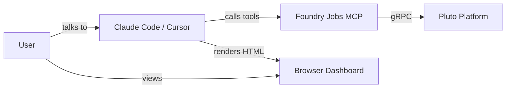

# Foundry Job Agent

An MCP server for managing GPU jobs on the Foundry (Pluto) compute platform. Works with **Claude Code** and **Cursor**. ([FFP-77972](https://jira.corp.adobe.com/browse/FFP-77972))

> [!TIP]
> For the broader compute jobs overview (submitting jobs, priorities, shared pool, utilization dashboards), see [`docs/compute-jobs.md`](../../../docs/compute-jobs.md).

## 1. What It Does

Natural-language access to job listing, quota inspection, job management, and a browser dashboard — all from any directory in Claude Code or Cursor.



<video src="https://github.com/user-attachments/assets/e90fac50-f6ef-4588-b188-7565ea355caf" width="100%" autoplay loop muted></video>

See [`design/app.md`](design/app.md) for the full app spec.

## 2. How to Install

```bash
curl -s https://dit-scale-up.s3.us-west-2.amazonaws.com/foundry-jobs/latest/install.py | bash
```

**Works everywhere:** Laptops and Pluto compute nodes. No authentication needed — packages download anonymously from S3.

This installs to `~/.foundry-jobs/` and registers the MCP server in both `~/.claude.json` (Claude Code) and `~/.cursor/mcp.json` (Cursor). Then open either tool anywhere and start talking.

### 2.1 Authentication

The MCP server requires Pluto platform authentication. On first use, say **"login"** in Claude Code or Cursor. This triggers a device code flow:

1. Claude shows you a URL and a code.
2. Open the URL in your browser and enter the code.
3. Tokens are cached locally at `~/.colligo/pluto_cli/msal-pluto-auth.secret`.

Tokens refresh automatically. Re-authenticate only if they expire (rare).

## 3. How to Use

Once installed, open Claude Code or Cursor from any directory and just talk. Examples:

**See what's running** — opens a live dashboard in the browser (auto-reloads every 10s):
```
> show me the jobs
> what's running?
> open dashboard
```

**Ask specific questions** — answered inline, no browser needed:
```
> what's the largest job right now?
> who owns the most H200 nodes?
> list the 3 oldest preemptible jobs in Foundry-TCCC
```

**Check quota**:
```
> show quota
> how much capacity does Foundry-THD have?
```

**Stop jobs**:
```
> stop job <name or ID>
> kill the 3 oldest preemptible jobs in Foundry-TCCC
```

**View utilization & cost dashboards** — opens Grafana dashboards with pre-filled filters:
```
> show me utilization for Foundry Unified Compute
> show me HFU for all Foundry
> show me cost dashboard
```

**Share a snapshot** — uploads a static HTML report to S3:
```
> save this view
> share the dashboard
```

**Customize the dashboard layout** — the default layout (`v1`) is read-only, so Claude will offer to create a custom copy you can iterate on:
```
> make the job names wider
> I want a layout that only shows job name, owner, and status
> create a custom layout called "compact"
```

## 4. MCP Tools

| Tool | Description |
|------|-------------|
| `login` | Authenticate to Pluto via device code flow |
| `list_jobs` | List jobs across Foundry initiatives (with filters) |
| `get_quota` | Per-project GPU/CPU quota usage |
| `stop_job` | Stop a running job by ID |
| `render_dashboard` | Open a live-updating HTML dashboard in the browser |
| `generate_report` | Render a static HTML report and upload to S3 for sharing |

## 5. [Changelog](CHANGELOG.md)

## 6. How to Develop

This is an **AI-native development** project:

- **`design/`** — Source of truth. Human reviews and edits this.
- **`src/`** — Derived code. The agent keeps it in sync with `design/`.
- **`plans/`** — Development plans. Every change starts with a new plan.

### 6.1 Workflow

1. Create a new plan under `plans/` describing what you want to change.
2. Work with the agent — it edits `design/` and `src/`.
3. You review `design/` files only. Don't worry about `src/`.

### 6.2 Setup

```bash
cd modeling/compute/job_agent
uv sync
```

Open Claude Code from this directory. The `.mcp.json` auto-registers the MCP server for development.

See [`CLAUDE.md`](CLAUDE.md) for SDK reference and development details.

### 6.3 Releasing

To make a new release, ask Claude: **"release"**. This generates a changelog entry, commits, and uploads to S3. See [`CLAUDE.md`](CLAUDE.md) section 3 for the full procedure.

## 7. Directory Structure

```
design/              # Source of truth (human reviews this)
  app.md             # App spec: workflows, initiatives, architecture
  runtime-context.md # MCP instructions for installed users
  layouts/           # Natural-language layout descriptions
src/                 # Implementation (agent manages this)
  foundry_jobs/      # Python package (server, client, render)
  container.jinja.html  # Shared HTML shell
  layouts/           # Jinja layout templates
  runtime_layouts/   # User-created layouts (at runtime)
plans/               # Development plans
```

